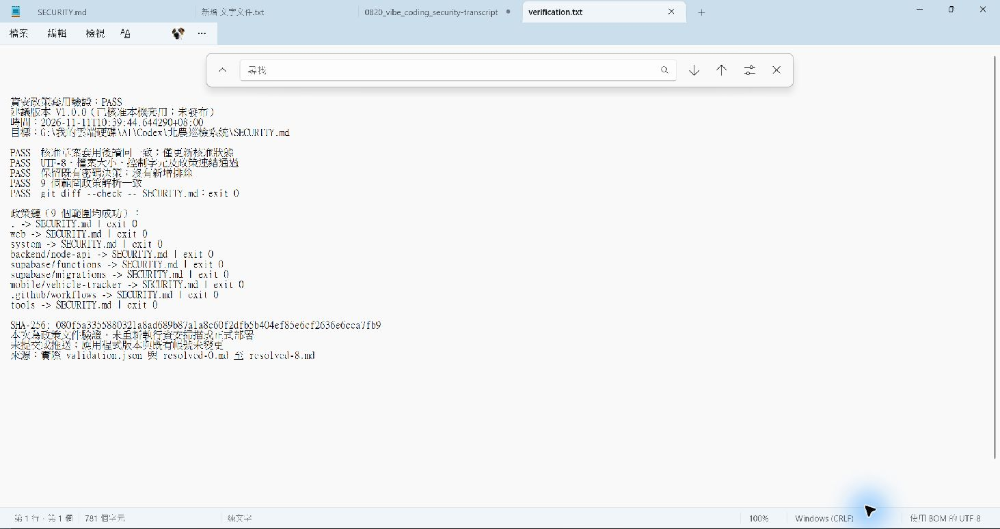
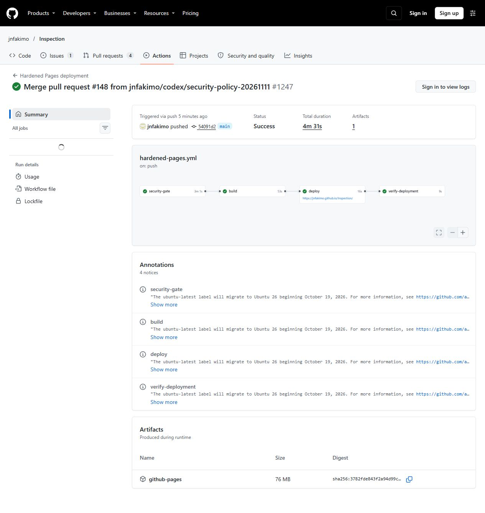
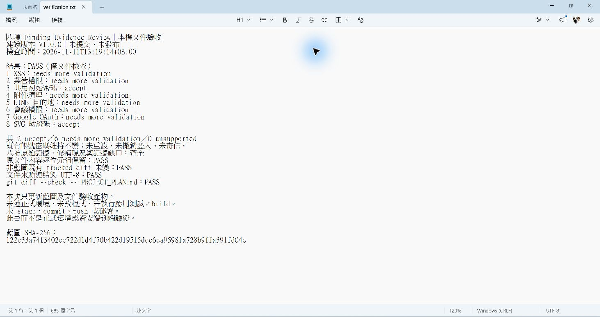
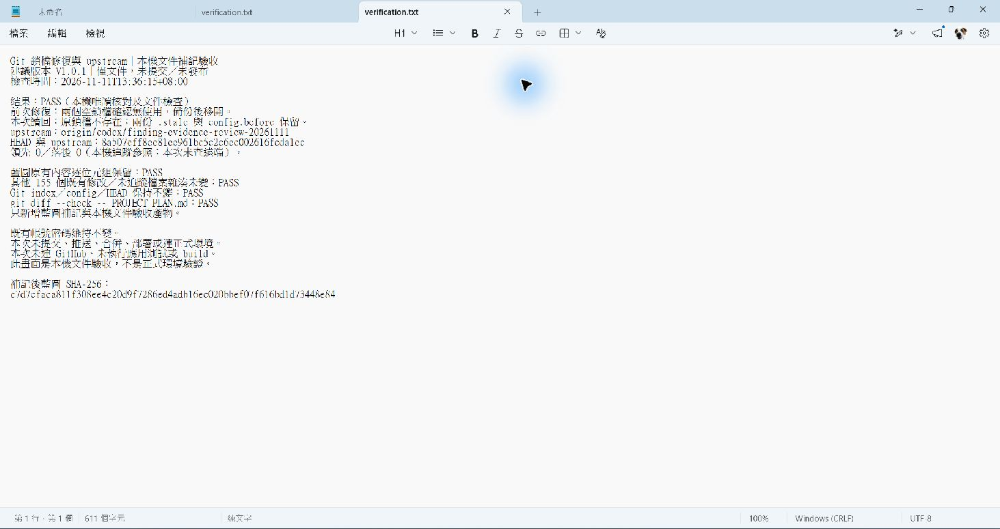
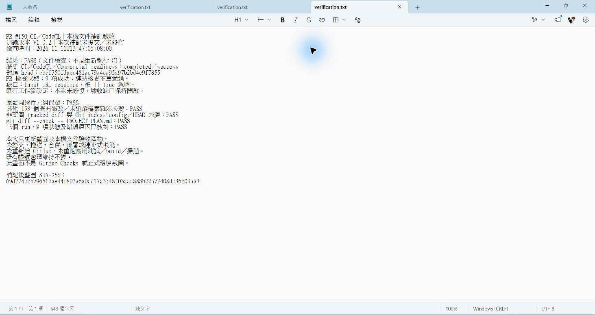
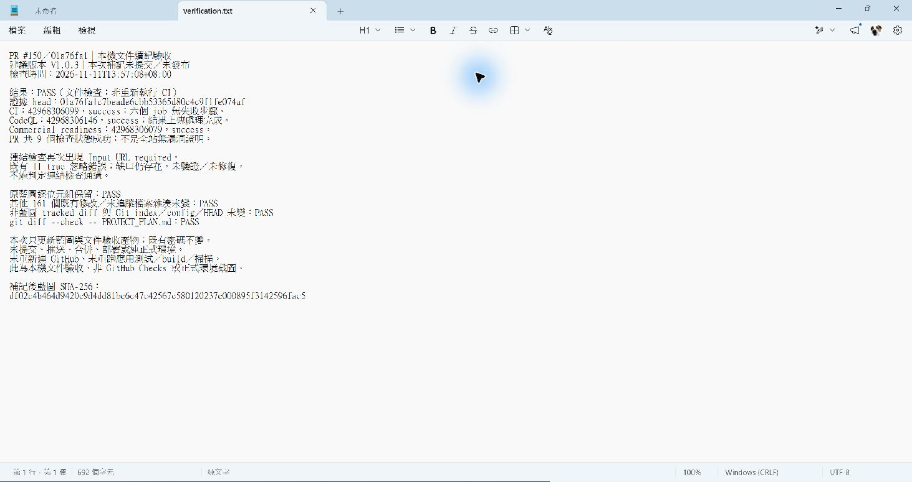
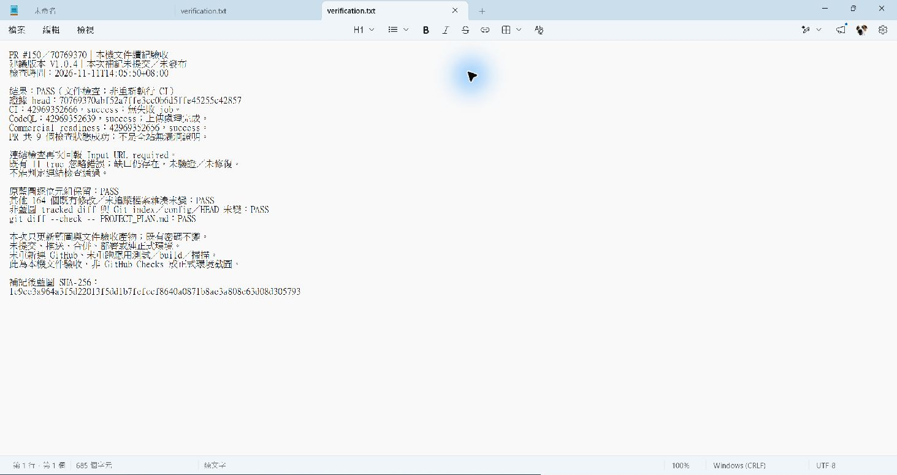
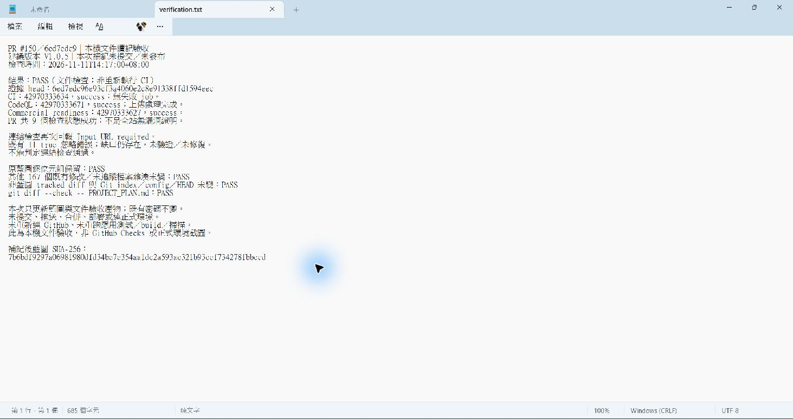

# PROJECT_PLAN.md — 北農巡檢系統統一化計畫與進度

> 2026-10-15 重寫。這份只放「目標、決策、工作流與進度、驗證證據、待辦」。
> 標準本身在 [`AGENTS.md`](AGENTS.md)；交接快照在 [`handoff.md`](handoff.md)；
> 舊版 1652 行流水帳封存於 `docs/archive/2026-10-15-pre-unification/PROJECT_PLAN.md`（含 2026-10-09 之前所有驗證證據與 SHA-256）。

## 1. 目標

2026-10-24 追加目標：先建立巡檢系統的 ISO/IEC 27001 導入與證據基礎；使用者指定優先修正 Next.js、certifi、主分支／發布管制。
前三項的 GitHub 發布、測試與讀回證據見 [ISO27001_BASELINE.md](docs/ISO27001_BASELINE.md)。後續風險與候選控制見 [ISO27001_RISK_REGISTER.md](docs/ISO27001_RISK_REGISTER.md)；正式主機與組織制度仍需獨立驗證，不宣稱已符合 ISO。

開發初期沒有先定義好主系統、各系統、子系統的版型與色彩規範，導致畫面不一致。本計畫把它們收斂成**單一標準**：

1. 範圍：1 個主入口、**13 個大系統、68 個子系統**，以及登入、手機操作、3 個全螢幕圖資工具頁。
2. 單一色彩正本 `web/app/tokens.css`，兩個主題（一般版／科技版）。
3. 單一品牌主色；系統之間不以顏色區分；綠／黃／紅只表示狀態。
4. 三層固定版型（主入口 → 系統入口 → 子系統頁），共用元件不另做第二套。
5. 文件可交接給任何 AI 工具，規範由自動檢查守門，不靠記憶。

## 2. 使用者決策（2026-10-15）

| 議題 | 決定 |
|---|---|
| 主題數量 | 保留一般版＋科技版，token 收斂為一份 |
| 13 個系統代表色 | 全站單一主色，系統只靠 Logo 與名稱區分 |
| 範圍 | 文件＋token＋共用元件＋全站硬編碼色碼，一次做完 |
| 舊文件 | 封存後重寫（不直接覆蓋） |
| 交接 | 文件必須讓其他 Agent 可直接接手（2026-10-15 追加） |

## 3. 證據分級

- **已驗證**：在 C 執行副本實際執行並通過（指令與結果寫在第 5 節）。
- **靜態驗證**：只由原始碼／守門腳本證明，沒有在瀏覽器實測。
- **未驗證**：尚未檢查，或受環境限制（瀏覽器啟動被政策阻擋、無登入帳號）。不得推測成功。

## 4. 工作流與進度

| 編號 | 工作 | 狀態 | 證據 |
|---|---|---|---|
| WS-0 | 封存舊 AGENTS／PROJECT_PLAN／handoff 至 `docs/archive/2026-10-15-pre-unification/`（雜湊與原檔一致） | 完成 | 靜態驗證 |
| WS-1 | 單一 token 層 `tokens.css`；移除 `globals.css`、`v1-layout.css` 內重複的主題定義；補上科技版缺的 `--cyan-text`／`--green-text` | 完成 | 已驗證 |
| WS-2 | CSS 硬編碼色碼遷移：UI 樣式 506 處改用 token（淺色值與原色碼逐一相同，一般版畫面不變；科技版改為正確深色對應） | 完成 | 已驗證（守門＋全測試） |
| WS-3 | 紙本／列印例外隔離：`.hs-report*`、`@media print` 保持固定白底，班別色在 `.hs-report` 內固定，不隨科技版主色變動 | 完成 | 已驗證（fixtures 測試） |
| WS-4 | 單一主色：移除 `.system-card`／`.maintenance-card`／`.quick-grid a` 的 amber／green／violet 變體；`modules.ts` 的 `tone` 欄位停用 | 完成（CSS）；`modules.ts` 與 `mobile/page.tsx` 的 `tone` 已於 §9 移除 | 靜態驗證 |
| WS-5 | 守門測試 `tools/color-token-check.mjs`（`npm run test:color-tokens`，已納入 `npm test`） | 完成 | 已驗證 |
| WS-6 | 重寫 AGENTS.md；業務／資料規則搬到 `docs/DOMAIN_RULES.md` | 完成 | 靜態驗證 |
| WS-7 | TSX 內聯色碼收斂：圖表色盤與 3D／圖面標記色在 `ALLOW_TSX` 白名單內；圖表色盤已集中到 `web/lib/chart-palette.ts`（§10），3D／圖面標記色尚未集中 | 圖表色盤完成；標記色**待辦** | `test:color-tokens` |
| WS-8 | 13 系統／67 子系統版型審查。已完成靜態審查：內容寬度統一為 `--content-width`（移除 `.operations-page` 1180px／640px 內縮、`.v1list-page` 1100px）；按鈕與頁首經查已符合標準。剩餘見第 8 節 | 進行中 | 靜態驗證 |
| WS-9 | 瀏覽器實測：一般版／科技版對比 ≥ 4.5:1、A4 列印、手機 375／320px 無水平溢出 | **未驗證** | — |

## 5. 驗證紀錄

環境：`C:\Users\jnfa\Documents\Codex\2026-10-09\Inspection-G-runtime`（G 槽 `node_modules` 不完整，不能在 G 直接跑測試）。

- 2026-10-15 G→C robocopy（含 WS-4 單一主色變更與三份新文件）後：`npm run typecheck:v2` exit 0；
  `npm test` exit 0（含 `test:color-tokens`）。這是目前最新的完整驗證。
- 為配合 token 搬遷而調整的測試：`font-token-check`、`input-select-standard-check`、`metric-card-standard-check`
  改讀 `tokens.css`；`handover-style-check`、`handover-report-style-fixtures.test` 改斷言 token 參照。

## 5a. 合併 origin/main（2026-10-15）

- 合併 36 個 commit（PR #55–#61：業管組交接簿預覽分頁、列印、共用視窗鍵盤操作、行動端相依修補、重複模組說明）。
- 衝突檔取 main 版本後重新套用本批轉換；合併後再跑色彩守門、typecheck 與完整測試（結果見 handoff.md）。

## 6. 風險與已知限制

- 一般版畫面預期與遷移前一致（token 淺色值＝原色碼）；少數近似色合併（例如 `#eef2f7`→`--n-100`、`#dcfce7`→`--ok-soft`）
  有肉眼難辨的色差，**未做畫面比對**。
- 科技版是主要受益者：原本寫死的淺色底（slate 系）現在會跟著主題反轉；實際視覺需瀏覽器確認（WS-9）。
- `modules.ts` 的 `tone` 欄位已移除（§9）；新程式碼不得重新引入，也不得用它改卡片顏色。
- 本批已分 4 組本機 commit（token 層、色碼遷移、守門測試、文件），未 push、未部署；被觸及的檔案內含先前未提交的既存修改，一併進入這些 commit。
- `.git/packed-refs.lock` 為 2026-10-06 遺留的 0 位元組鎖檔，commit 時會印警告但不影響結果；確認沒有其他 git 程序後再清除。

## 7. 待辦（依優先序）

1. WS-8：逐系統版型審查，產出「不符三層標準的頁面清單」再分批修。
2. WS-9：取得可用瀏覽器與測試帳號後做兩主題＋手機＋A4 視覺驗收。
3. WS-7：圖表色盤已集中（`web/lib/chart-palette.ts`，§10）；剩 3D／圖面標記色（`structuremap-*`、`repair-map3d`、`patrol-map3d`、`modeler-client` 等）尚未集中，`ALLOW_TSX` 仍列這些檔。
4. （已完成，§9）移除 `modules.ts` 的 `tone` 欄位與相關型別、`mobile/page.tsx` 的 `tone` 類別。
5. 承接自舊計畫、尚未完成：全角色權限矩陣、資安 S1–S3 分階段驗證、Obsidian/04 的 179 節歷史索引人工審閱
   （細節在封存版 `PROJECT_PLAN.md`、`SECURITY_POSTURE.md`）。

## 8. WS-8 靜態版型審查結果（2026-10-15）

方法：掃描 94 個 tsx 檔的行內版面樣式、`<h1>`、原生日期欄位與非標準按鈕類別，並比對各 CSS 的頁面層寬度規則。

- **符合**：`<h1>` 只出現在主入口、`SystemPageHeader`、建模頁與列印視窗；原生 date/time 只在三個共用元件內；
  非標準按鈕類別 24 個，多數同時帶 `primary-btn`／`secondary-btn` 或為篩選／圖示按鈕。
- **已修**：內容寬度分歧（見 WS-8）。
- **已修**：`vehicle-workspace.tsx` 的行內版面樣式（流程卡、KPI 卡、頁籤、報表彈窗共 57 處）改為 class，
  並移除 `admin-workspace.css` 中為了覆蓋行內樣式而寫的 `!important`；派車報表與 KPI 在 ≤640px 改兩欄。
- **待處理（行內版面樣式過多，media query 蓋不過）**：`DashboardWidgetContent.tsx`（155 處，戰情元件動態版面，需評估）、
  `LayoutsAdmin.tsx`（107，每處樣式幾乎都是獨一份且依狀態變色，需要畫面比對才能安全轉換）、
  `business-handover.tsx`（11，多為表格欄寬）。
- **待處理（自有樣式的按鈕）**：`modeler-button*`（建模頁）、`business-check-btn`／`complete-btn`（點檢切換）；
  確認是否應收進 `button-standard.css` 或維持為切換元件。
- **未做**：逐頁實際畫面比對（需瀏覽器與登入）。

## 9. 統一化後續修正（2026-10-15，PR #62 合併後）

- 正式站登入頁實測（一般版／科技版、375px）：科技版「登入」按鈕亮青底白字只有 1.77:1。新增 `--primary-solid`／`--on-primary-solid`，兩主題皆 ≥ 4.5:1。
- 全站另有 9 處亮色實心底配白字（業管組時段標籤、當班徽章、簽名圖示、資安告警），科技版對比不足；新增 `--on-bright`（一般版白字不變、科技版深色字），並在 `test:color-tokens` 擋下同類寫法。
- 移除 `modules.ts` 已停用的 `tone` 欄位與主入口、手機頁的 tone 類別。
- 清除 `Obsidian/04-開發與部署.md` 殘留的 `- Dependabot 2 項高風險（`braces`、`node-forge`，皆在 `mobile/vehicle-tracker` 建置相依）目前沒有修補版本，列為已知風險。
- 交接簿表格欄寬的行內樣式（`business-handover.tsx`）屬列印表格且已有 PDF 分頁驗證，這輪不動。
- 仍未驗證：一般版當班徽章白字配 `#10b981` 約 2.5:1（改版前即如此）；需登入的頁面尚未在瀏覽器實測。

## 10. 第三輪（2026-10-15，分支 codex/unification-round3）

- 建模頁與業管組點檢切換按鈕改用共用 `.primary-btn`／`.secondary-btn`（點檢切換以 `aria-pressed` 呈現選取），移除各自的按鈕外觀。
- 當班徽章（業管組時段、即時文字、當班中）改為 `--live-solid` 深綠底白字，兩主題約 5.5:1。
- 新增 `web/lib/chart-palette.ts` 集中圖表系列色與備援色；6 個圖表檔移出 `color-token-check` 白名單。
- 刪除 G 槽遺留的 `.git/packed-refs.lock`（0 位元組，2026-10-06）。
- G 槽未提交修改唯讀盤點：見 `docs/G_WORKTREE_INVENTORY_20261015.md`（146 個與 main 相同、57 個不同、92 個 main 上沒有）。
- **待決策**：`DashboardWidgetContent.tsx` 顯示的是模擬數字（每 2.5 秒跳動），用在後台預覽與電視牆 `tv-dashboard`，畫面未標示「示意」。需決定接真實資料或標示示意，再處理其 255 處行內樣式。
- **待登入**：`LayoutsAdmin.tsx` 107 處行內樣式需在登入後邊看畫面邊改。

## 11. 戰情元件改接真實資料（2026-10-15，分支 codex/dashboard-live-data）

- 使用者決定：電視牆與後台版面預覽的 32 種元件改接真實資料，不再顯示模擬數字。
- 27 種接上真實資料：報修／工單（10）、巡邏（2）、設備妥善率（1）、天氣（3，中央氣象署）、市場行情（11，`dashboard_market_rotation` board）。
- 5 種目前沒有資料來源，改顯示「尚未介接資料來源」：攝影機畫面、卸貨場車流、拍賣場次進度、產地到貨排行、市場配置。
- 行情的「成交總額」是成交量 × 量加權均價的估算；「歷史價格曲線」畫看板資料的近一個月（約 24 個交易日），「每週交易趨勢」取最近 7 個、「成交總額」取最近 8 個交易日（2026-10-15 正式站實測後修正，原誤寫為只有 7 日）；跑馬燈是最新交易日漲跌，不是即時拍賣批次。畫面都照實標示。
- 新增 `web/lib/dashboard-widget-catalog.ts`（元件清單單一來源，取代後台與電視牆各自一份）、`web/lib/dashboard-metrics.ts`（與戰情儀表板同一統計口徑，戰情儀表板也改用它）、`web/lib/dashboard-live-data.ts`（同頁共用查詢、每 60 秒更新）。
- 驗證：`test:dashboard-metrics` 7 項、typecheck、完整 `npm test`。電視牆畫面需登入，尚未在瀏覽器實測。

## 12. 正式站驗收修正（2026-10-15，分支 codex/card-tone-cleanup）

- 1280px 實測維修／派工入口：6 張卡片尺寸皆為 269×200，但上緣與文字色分成兩種（原 cyan 卡為淺藍、原 amber／green 卡為主色）。原因是 PR #62 只刪除變體規則，沒刪掉預設規則裡的 `:not(.amber):not(.green)` 排除條件。
- 修正：卡片基礎規則直接使用 `--icon-sky`／`--icon-sky-text`，移除重複覆寫；`test:color-tokens` 新增規則，擋下依系統分色的卡片選擇器（含 `:not()` 寫法）。
- 主入口 13 張系統卡實測一致；電視牆 PR #65／#66 實測讀到真實資料。

## 13. 入口卡片位置分色清理（2026-10-15，分支 codex/portal-card-tone）

- 正式站 1280px 實測駐衛警入口：卡片上緣依位置分成 4 種顏色（`.operations-portal-card:nth-child(n)`），公務車、公文入口另有一套；「● 系統連線」11px 文字對比 3.77:1。
- 修正：入口卡片、公務車模組卡的上緣一律 `--icon-sky`，移除依位置分色的規則；系統連線文字改 `--green-text`。
- 守門：`test:color-tokens` 限制卡片（system-card、maintenance-card、operations-portal-card、module-grid、quick-grid）的上緣色只能用 `--icon-sky` 或邊線色。
- 收工時狀態：PR #62–#67 已合併並部署；本分支待開 PR。其餘頁面驗收待續。

## 14. 正式站全面驗收（2026-10-15，分支 codex/admin-hub-accent）

- 系統入口（1280px）：交接簿、設備、圖臺、會議室符合標準。修正三項：
  - 後台入口 11 張卡片寫死 6 種強調色，標籤與「▶ 開啟子系統」用淺藍當字色只有 1.67:1；改為統一淺藍，文字用 `--icon-sky-text`。守門的 tsx 關鍵字補上 `accent`。
  - 市場營運分析、市場公開看板、公務車定位追蹤入口仍走舊的 `module-hero` 版型；改用共用頁首，`.module-grid` 卡片上緣改為 `--icon-sky`。
- 子系統頁：報修案件、設備主檔、派車申請、業管組交接簿版型符合標準（頁首 26px／左緣 80px、欄位 42px、內容 85%、無溢出）。
- 列印預覽：科技版下 A4 預覽仍為白底黑字（紙本例外正確）。
- 科技版：報修案件 0 處對比不足；業管組交接簿第 3、4 班編號白字配亮底 1.79:1，改用 `--on-bright`。
- 手機：375／320px 派車申請、報修案件、交接簿皆無水平溢出，表格切換為卡片。
- **待決策（一般版色彩 token）**：主色 `#0284c7` 當小字約 4.1:1、綠 `#059669` 約 3.77:1、次要文字 `#64748b` 在斑馬列底約 4.35:1，皆略低於 4.5:1，影響多數子系統頁。需決定是否把一般版的這三個 token 調深一階。

## 15. 看板內部資訊外洩修正（2026-10-15，分支 codex/board-notice-allowlist）

- 使用者在正式站看到市場看板跑馬燈出現「API Gateway 流量突增」「synthetic probe 異常」（含告警編號）與派車提醒（含單號），並要求依 ISO/IEC 27001 處理。
- 原因：登入版跑馬燈沿用通知中心「全部通知」（event 為空或非停用公告），且以 service role 查詢、不分收件人，會帶出每位管理員收到的資安告警副本（含告警內容）與他人通知；公開版原本已限制為 `board_notice`。
- 修正：兩種檢視都只讀 `event='board_notice'` 且無收件人的公告（`market-board-notices.ts`）。`board-notices-check` 新增案例，確認資安告警、監控異常與個人通知在兩種檢視都不會出現，停用公告後不得退回顯示其他通知。
- 行為變更：登入版跑馬燈不再顯示一般通知；現場人員要看這些通知請用通知中心。需要在看板顯示的訊息，由具權限者在後台「看板公告」發布。
- 部署：此變更在 Edge Function（`app-api`），合併進 main 後由 `deploy-edge-functions.yml` 自動部署。
- 後續處理：見第 18 節。原先寫的「告警寫入 notifications 且沒有收件人」不正確：告警本體一直存在專用的 `security_alerts`（RLS 強制、僅管理員），通知中心的是每位管理員一份的副本（有收件人）。

## 16. 一般版色彩 token 對比調整（2026-10-15，分支 codex/token-contrast）

- 使用者決定調深一般版的主色、綠與次要文字，使小字在白底、斑馬列底與淡色底都 ≥ 4.5:1。
- 調整：`--cyan` #0284c7→#0369a1、`--green` #059669→#047857、`--muted`／`--n-500` #64748b→#5a6a80、`--dim` #5f6f85→#5a6a80。
- 一併調整（同類問題）：`--amber` #b45309→#a04607（淡色底上 4.1–4.4:1）、`--red` #dc2626→#c81e1e（斑馬列 4.44:1）。
- 一般版 `--on-primary` 改為白字（深藍底配深字只有 3.6:1）；科技版不變。紙本報表與列印版使用固定色，不受影響。
- 外觀影響：一般版主色、按鈕、連結與狀態色整體略深；科技版不變。

## 17. 一般版主色調整幅度（2026-10-15，分支 codex/primary-70）

- 使用者覺得 PR #70 的主色略重，要求「調整 70%」。解讀為：主色採原值 `#0284c7` 到 `#0369a1` 的 70% 位置。
- `--cyan`、`--primary-solid`：`#0369a1` → `#0371ac`。對比：白底 5.3、斑馬列底 4.9、淡藍底 4.6，仍全數 ≥ 4.5:1。
- 小字用的 `--info-text`（#0369a1）維持不變。若要更淺，淺於 `#0377b4` 就會在淡色底低於 4.5:1。

## 18. 資安告警存放與保存期限（2026-10-15，分支 codex/security-alert-store）

- 調查結果：告警本體已在專用資料表 `security_alerts`（RLS 強制、僅管理員可讀、寫入只走 service role）；證據資料表有防刪除 trigger。真正的缺口是：(1) 通知中心副本複製了完整告警內容；(2) 副本沒有保存期限。
- 修正：副本改為只放提示與告警編號；新增 `redact_expired_security_notices()`（90 天後清除內容、不實體刪除，僅 service role），由 `platform-log-alert` 每日（臺灣時間 03 點）呼叫。
- 刻意不做：證據資料表的自動刪除。這需要解除既有防刪除保護，屬政策決定，已列在 `docs/SECURITY_RECORD_RETENTION.md` 待決定項目。
- 部署順序：migration 需先經 `apply-database-migration.yml` 套用；在套用前，`platform-log-alert` 呼叫清除函式只會記錄錯誤，不影響告警流程。
- 守門：`npm run test:security-notice-minimal`。

## 19. 隱藏測試資料不計入統計（2026-10-16，分支 codex/ui-followup-20261016）

- 起因：正式庫有 3 筆 2026-08-25 的 E2E 測試工單，對應報修案件已 `hidden = true`，工單仍 `hidden = false`（`docs/runbooks/hide-test-records.sql` 的步驟 1 預覽結果）。
- 讀取端盤點（靜態，未查正式資料）：
  - **已略過 hidden**：戰情儀表板（`dashboard-client.tsx`、`dashboard-live-data.ts`）、交接簿工作區報修查詢、`repair_monthly_counts` RPC。
  - **本批補上**：`workorder-extras.tsx` 的維修分析（報修與工單）、`LocationAnalysisAdmin.tsx` 的位置分析，改用 `.or('hidden.is.null,hidden.eq.false')`（NULL 視同未隱藏）。守門：`npm run test:hidden-record-filter`，含反例斷言。
  - **刻意未動**：`app-api` 的報修案件列表（`select('*')`）與 `structuremap-markerboard.tsx` 的報修挑選清單。前者是管理端列表，是否顯示隱藏列屬產品決定，且動到 `supabase/functions/**` 合併後會自動部署 Edge Function。
- 注意：維修分析原本註明「逐項沿用 V1 analytics.html，確保兩邊數字一致」；V1 沒有過濾 hidden，所以 V2 與 V1 在測試資料上會有差異，V1 為維護模式，不再同步。
- 處置：runbook 步驟 2 在 SQL Editor 會被 `trg_protect_technician_order_columns`／`trg_protect_repair_request_columns` 擋下（postgres 身分沒有登入者，`can_manage_workorder()` 為 false），這也解釋了為何報修案件已隱藏而工單沒有。改用 migration `20261016090000_hide_e2e_test_workorders.sql`：只動以 `request_id` 核對過的 3 組、交易內暫停並恢復兩個保護觸發器、只改 `hidden`、事後驗證；空資料庫略過、資料不符整筆回滾。守門 `npm run test:hide-e2e-migration`（PGlite，含根因重現與「不暫停觸發器就失敗」的反例）。套用走 `apply-database-migration.yml`。
- 套用結果（2026-10-16）：分支 CI run 38820146953（5 個 job）通過後，apply-database-migration run 38820368083 套用到正式專案 `qztffronusdhgxhjjubt`，HTTP 201。目標工單確實存在於該專案（使用者截圖），migration 不會走「略過」路徑；事後驗證未通過會回滾，所以 201 代表 6 筆皆已隱藏、觸發器已恢復。Management API 不回傳 NOTICE，筆數未直接讀回。
- 本批沒有改：`LayoutsAdmin.tsx` 行內樣式（§11 已標示需登入後邊看畫面邊改）、`business-handover.tsx` 欄寬行內樣式（§9 已決定不動）。這兩項沒有帳號與瀏覽器就不應盲改。

## 20. G 槽快照分類與正式環境落差（2026-10-16，分支 codex/handoff-snapshot-triage）

- 快照 commit `9363fb870`（151 檔）以分岔點 `05c99c619`、目前 main 與 main 歷史上所有版本做三方比對，並忽略 CRLF／行尾空白：
  - 已在 main 或只是舊版本：12 檔（5 檔只差換行、7 檔是 main 歷史上的舊版）。
  - **新檔 91**：天氣地圖 Blender 原始檔 48（11.8 MiB，含 `.blend`／`.glb`）、`supabase/functions` 22、migration 5、`web/app` 7、`tools` 4、`web/lib` 3、`docs` 2。
  - **實質修改 48**：多數是 Edge Function（`app-api`、`admin-api`、`line-notify`）、後台元件與文件。
- 主要的未發布功能群：(1) 車輛 LINE 個人通知（migration 5 支、`vehicle-line-dispatch-worker`、`_shared/vehicle-*`、`admin-api` 個人 LINE 管理、`/systems/vehicle/notification-preview`）；
  (2) 繁中 404 頁（`web/app/not-found.tsx`，10-15 曾離線驗證）；(3) 設備營運／能源元件 `equipment-operations-energy.tsx`；(4) `async-load-safety`、`request-sequence` 測試；(5) 天氣地圖設計原始檔。
- **正式環境落差**：(1) 的 Edge Functions 與 migration 於 10-08 從 G 直接部署（`app-api` v118、`admin-api` v53／v54、`line-notify` v31、worker v1），原始碼從未進 main。
  10-15 `deploy-edge-functions` run 38748430358（PR #71 改 `app-api`）與 run 38771047188（PR #73 改 `_shared`）以 main 版重新部署
  `admin-api, app-api, audit-event, error-threshold-check, patrol-checkin, patrol-timeout-check, platform-log-alert, username-login`，
  因此正式環境的 `app-api`／`admin-api` 已不含 LINE 個人通知；`line-notify`、worker 未被重新部署，6 張相關資料表仍在。
  10-08 紀錄為功能開關全關、outbox／cron 為 0；開關現況需要正式庫讀取權限才能重查，本批未查。
- 處置：146 個未發布檔案匯出到 `G:\我的雲端硬碟\AI\Codex\_backups\g-snapshot-20261015-unpublished\`（zip、`manifest.tsv` 分類清單、bundle、G 槽 Obsidian 本機修改 patch），
  之後 G 槽以 `checkout -f -B main origin/main` 切回 main（未提交的 143 項與 main 位元組相同）。快照分支保留在本機，不推到公開 repo。
- 同批清理：移除 17 個 `AppData\Local\Temp` 暫存 worktree（檔案已被系統清空，只剩刪除狀態，無修改或新增檔；分支全部保留）、
  移除 `wt-followup-20261016` 與舊日常副本 `wt-merge-main-20261015`（皆先拆 `node_modules` junction，執行副本 `node_modules` 前後皆 140 項），
  刪除已合併的 `codex/ui-followup-20261016`、`codex/handoff-after-pr75`、`codex/handoff-security-store`（遠端與本機）。
  其餘 worktree 保留：`C:\projects\Inspection`、`.codex` 與 `Documents\Codex\2026-10-10`／`2026-10-13` 的 Codex 工作目錄（可能仍由 Codex 使用）。
- **待決定**：車輛 LINE 個人通知要 (a) 恢復上線——以 main 為基底重新整合 (1)，補測試後經 PR 部署；還是 (b) 放棄——至少把 5 支已套用的 migration 補進 main 作為 schema 紀錄。
  (2)～(5) 可在決定後逐項以獨立 PR 帶回。

## 21. 公務車個人 LINE 派車通知重新上線（2026-10-16，PR #78）

- 背景：見 §20。使用者決定恢復上線，並說明正式站目前沒有這個功能。
- 整合方式：以 main 為基底，從快照只取車輛 LINE 相關檔案——新檔 26 個（Edge Function 相關 20、migration 5、規格文件 1）；既有檔中 `admin-api/index.ts`、
  `app-api/handlers/vehicle.ts`、`line-notify/index.ts`、`config.toml`、`tools/admin-line-test-check.mjs` 採快照版（逐段確認差異都屬此功能，main 自分岔點後未改這些檔）。
  `app-api/index.ts`、`system-access.ts`、`permission-fail-closed-check.mjs` 的快照差異屬另一批權限重構或較舊內容，刻意不帶入；假資料示意頁不帶入。
- 修正：`_shared/vehicle-line-webhook.ts` 的 `flatMap` 型別錯誤（`deno check line-notify` 原本失敗，部署前檢查會擋下）。
- 新做前端（快照中沒有可用介面）：`web/components/VehicleLineLinkSection.tsx`（個人設定綁定，僅公務車系統權限者）、
  `web/app/systems/admin/settings/vehicle-line-personal-panel.tsx`（後台開關與測試，真實訊息需二次確認）；`vehicle_line_*` 列入只走 Edge 的動作。
- 排程：`.github/workflows/vehicle-line-dispatch-worker.yml` 每 5 分鐘，沿用 repo secrets `CRON_SECRET`／`SUPABASE_ANON_KEY`，不使用 pg_cron／Vault。
- 測試：`npm run test:vehicle-line-notifications`（單元 46、前端 13、PGlite／路由 28，共 87 項）接入 `npm test`；gitleaks 兩筆測試 UUID 誤判以指紋白名單＋變數改名處理。
- 上線紀錄：PR CI run 38828543746 通過 → apply-database-migration run 38828829292、38828859064、38828892955、38828933713、38828963343 依序套用五支 migration（皆 HTTP 201）
  → 合併 `875b7215d`。自動部署 run 38829051295 因 `config.toml` 變更觸發全量部署，型別檢查在 `ipcam-proxy` 的 `npm:md5` 失敗（CI 無 node_modules），
  未部署任何 function；改以 workflow_dispatch run 38829266322 只部署 `admin-api app-api line-notify vehicle-line-dispatch-worker`，成功。
  手動觸發 worker 排程 run 38829377581 回傳 `{"ok":true,"data":{"claimed":0,...}}`，代表 `CRON_SECRET`、資料庫 RPC 皆正常；Pages 已含新介面。
- 後續修正：部署流程型別檢查加上 `DENO_NO_PACKAGE_JSON=1`，本機重現失敗並驗證 18 支 function 全數通過（分支 `codex/deploy-check-and-handoff`）。
- 未驗證：登入後畫面、真實 LINE 綁定與送達（需司機本人）、`LINE_CHANNEL_SECRET` 與 LINE webhook 設定是否就緒（無正式環境讀取權限）。
- 2026-10-16 追加（PR #80，`06f027bb7`）：發現 Codex 於 10-08 寫好但未進 main 的前端（舊 C 副本 `Documents\Codex\2026-10-05\task-2\Inspection`：
  `vehicle-line-binding-panel.tsx`、`vehicle-line-personal-settings.tsx`、`web/lib/vehicle-line-binding.ts`）。使用者決定維持現行介面，整合 Codex 的
  回應驗證、代碼格式檢查、防連點動作鎖、錯誤分類與測試；修正分類規則漏判 app-api 實際訊息「駕駛名單」「駕駛綁定資格」，並以讀取伺服器原始碼的測試防止脫節。
  派車申請頁加入同一綁定元件（僅駕駛名冊人員顯示）。`test:vehicle-line-notifications` 共 100 項。
- 正式環境進度：LINE webhook Verify 成功、022443 已綁定；待管理員發送測試後逐項開啟個人通知。
- 2026-10-16 正式啟用：管理員於後台送出個人測試訊息（回應「測試通知已由 LINE API 接受」），022443 確認收到；隨後開啟「啟用個人通知」「指派通知」並儲存，
  伺服器讀回狀態一致。「取消指派通知」關閉、「測試模式」開啟（皆維持原狀）。未驗證：真實派車指派觸發的通知送達（需實際派車）。

## 22. 繁中 404 頁與非同步載入防呆（2026-10-16，PR #83、#84）

- 404：正式站不存在的網址原本顯示 GitHub 預設英文頁。帶入快照的 `web/app/not-found.tsx`，並讓 `build-hardened-pages.mjs` 在加上 CSP 與來源指紋之後、
  簽章之前把 `v2/404.html` 複製為網站根目錄 `404.html`（GitHub Pages 只讀根目錄），且確認內容為繁中頁。PR CI 的 Commercial readiness 建置紀錄
  「根目錄 404 頁：v2/404.html → 404.html」，產物驗證通過；合併後實測 `/Inspection/v2/<不存在>/` 與 `/Inspection/<不存在>` 皆回 HTTP 404 並顯示繁中頁。
- 載入防呆：自快照整合 Codex 10-10 的修正，共 11 個畫面——設備頁（#83）、戰情、會議室、公文、駐警打卡、維修分析、後台告警／通知（#84）以
  `request-sequence` 丟棄過期回應並於卸載時作廢；查詢失敗不顯示假的空清單；權限頁任一授權來源失敗即封鎖編輯；AuthGate 過期回應不得清除登入者。
  `dashboard-client`、`workorder-extras` 以三方合併保留 main 的後續修改。測試：`async-load-safety.test.ts`（Codex 完整版＋補充）、`request-sequence.test.ts`、`not-found-page.test.mjs`。
- 待決定：設備營運／能源面板（見 handoff 4a）。未驗證：登入後畫面。
- 2026-10-16 追加（PR #86）：使用者決定能源面板先上線。中央監控（`equipment_monitor_events`）頁上方顯示 Codex 的 `equipment-operations-energy`；
  已接上監控告警，其餘標示「待介接」。Codex 元件測試 9 項接入 `npm test`，並改對應色彩統一後的 token、以實體檔案載入取代 `new Function`（Semgrep 規則）。
  正式站已部署（Pages run 38878399649），未登入實測畫面。

## 23. 業管組批核四階與批核前預覽（2026-10-20，PR #88）

- 需求：一市場主任之前多一關副主任；點選批核時先預覽報表再批核（比照機電課、駐警隊）。
- 決定：副主任身分依 `users.supervisor_id` 組織鏈判斷（不另設名單）；一市場啟用、二市場先維持三階（二市場副主任資料未備妥）。一市場人員：副主任莊宗坤、主任簡文財。
- 規則：已啟用的市場整體上移一層（副主任＝該市場主管 0 層、主任 1 層、副理 2 層、經理 3 層），未啟用的市場與原三階完全相同；
  主任須在同市場、同交接日的副主任批核之後才能批核（資料庫觸發器，回中文訊息）；關卡自 2026-10-21 起，歷史日期維持三階、不補批。
  系統管理員可批核任一階，但二市場沒有副主任階段。啟用日在 migration 與前端各一份，有測試逐市場比對。
- 實作：migration `20261020090000_business_handover_deputy_director_stage.sql`（`business_supervisor_within` 層數判斷、啟用日函式、關卡觸發器、階段檢查加入 `deputy_director`）、
  `app-api` `business_approve`、`web/lib/business-handover-approval.ts`、`business-handover.tsx`／`.css`（預覽內批核、四欄版面）；交接簿雜湊鎖檔同步三個檔案。
- 驗證：PGlite 測試涵蓋一市場四階矩陣、二市場原三階矩陣與無關卡；前端判斷與畫面契約 11 項；typecheck、完整 npm test、gitleaks、Semgrep、deno check、CI 與 Commercial readiness 皆通過。
- 上線：使用者先建好莊宗坤 → 簡文財的上下級並以唯讀查詢確認組織鏈 → apply-database-migration run 39371394023（HTTP 201）→ 合併 `31fbc3446` → `app-api` 與 Pages 部署成功。
- 未驗證：登入後實際畫面、A4 列印分頁、副主任階段的名單限制（目前該市場所有主管皆有資格）。

## 24. 公務車定位 App 升級 Expo SDK 58（2026-11-04）

- 範圍只限 `mobile/vehicle-tracker`。未改 Supabase migrations、網站或 Edge Functions。
- 版本：Expo 57.0.20 → 58.0.23，React 19.2.3 → 19.3.0，React Native 0.86.3 → 0.88.1；`expo-constants`、`expo-crypto`、`expo-dev-client`、`expo-location`、`expo-secure-store`、`expo-system-ui`、`expo-task-manager`、`@types/react` 由 `npx expo install --fix` 對齊 SDK 58。
- 程式：React Native 0.88 嚴格型別下，`PermissionsAndroid.requestMultiple` 的權限陣列必須是 `Permission[]`（`src/ble.ts`）。未使用已移除的 `InteractionManager`、`Touchable`、`Modal.animated` 或已移除的 `StatusBar` 屬性；沒有 Expo Router，也沒有提交 `android`／`ios` 目錄。
- 公告：安裝樹不再含 `zod` 或 `deepmerge`。`node-forge` 為 1.4.3，與未合併的 PR #137 目標版本相同，SDK 58 不需要該 override。`glob` 14.0.3 與 `minimatch` 11.0.4 的 override 仍需要；拿掉後 `npm audit` 回到 5 個 moderate。
- 驗證：`npm ci`、`npm audit` 0、`npm run typecheck`、`npm run test:storage` 4 項、`tools/vehicle-tracking-ble.test.mjs` 8 項、Android／iOS `expo export`（Hermes）、`expo-doctor` 20/20。
- 未驗證：實體 iPhone／Android 的新 development build、背景定位、藍牙、既有安裝的加密儲存升級、Android release R8、iOS 27 可調整視窗。

## 25. 唯讀資安檢查與 Referrer-Policy（2026-11-06，PR #141、#142）

- 範圍：以 `web-security-review` 檢查 `origin/main` `3ba85f1e`（PR #140）與正式庫，全程唯讀；結果與證據摘要見 `handoff.md` 同日條目（PR #141）。
- 結論：**未發現可被外部利用的漏洞**。RLS、definer view、全開 policy、definer 函式 `search_path`、公開桶、anon 殘留權限皆 0 列；
  模擬無角色登入者讀 106 張表／view 為 0 筆，寫入 71／72 張表全被擋；Auth `disable_signup=true`；`verify_jwt=false` 的 4 個 Edge Function 已確認有簽章／state／排程密鑰／captcha 把關。
- 需使用者處理：Supabase advisor 顯示**外洩密碼保護未開啟**，與 2026-10-29 紀錄不符；須在儀表板 Authentication → Email 開啟後以 advisor 讀回。
- 修正（PR #142）：GitHub Pages 無法設回應標頭，`tools/build-hardened-pages.mjs` 在每個 HTML 注入 `<meta name="referrer" content="strict-origin-when-cross-origin">`，
  缺少即建置失敗；`tools/scan-all-pages.mjs` 部署後同樣檢查。本機 `build:pages` 138 頁、全站掃描、commercial readiness 0 錯誤、`npm test`（除 Windows CRLF 已知的 `test:handover-source-parity`）通過。
- 檢查工具：`site-scan.mjs` 的 meta CSP 比對遇單引號截斷，造成「缺 `object-src 'none'`」誤報（正式站本來就有），已在 dotfiles `439630f` 修正並部署。
- 不做：`nosniff`、`frame-ancestors` 只能用回應標頭（需 CDN／代理）；`btree_gist` 移出 public schema 無實際攻擊面，且可能影響公務車時段排除約束，不動正式庫。
- 未涵蓋：真實帳號實打 API、Edge Function 逐行審查、`cwa-weather`／`vehicle-line-dispatch-worker` 的把關確認、`mobile/`。

## 2026-11-06 八項資安修補發布候選

- 使用者授權正式發布；以最新 main 為基底整合 G 槽八項修補，隔離其他未提交工作。
- 修補範圍：附件誤刪、LINE 群組自動接管、共用初始密碼、業管／會議模組拒絕繞過、樓層 XSS、OAuth 跨瀏覽器綁定、SVG 驗證碼答案外洩。
- 新增 `20261106050736_codex_security_boundary_fixes.sql`，先套正式庫再發布 Edge 與 Pages。
- 發布候選的六項攻擊路徑與合法對照測試、V2 型別檢查已通過。完整 CI、正式 migration 與部署驗證結果待發布後補記。
- 現有使用者密碼不會自動變更；舊共用密碼帳號的精準清查／重設與 session 撤銷、真實 Google 同意及郵件送達，均須另有驗證證據。

## 2026-11-06 告警等級顯示獨立修復

- 基底：最新 `main` `0465a35dc744651541d1c240bbca5f0e79056bc1`；獨立分支 `fix/equipment-severity-20261106`，工作區 `/workspace/Inspection-severity-release`，本批由 Codex 單一寫入。
- 僅修正設備概覽、追溯及事件明細的告警等級：一般／警告／嚴重，缺少、非法及原型屬性名稱一律顯示「未知」。新增純顯示 helper 與 4 項聚焦測試，接入既有 `test:equipment-energy`；共用 Pill、其他狀態欄位、API enum、資料庫與告警判斷不變。
- 已通過：`npm test`（含 PGlite、既有派車回歸、最新資安邊界及設備測試）、`npm run typecheck:v2`、`npm run security:audit`、`npm run security:secrets`、`npm run security:gitleaks`、`npm run security:semgrep`、`npm run build:pages`（138 頁）、`git diff --check`。安全設計檢查 0 錯誤、3 個既有警告；Semgrep 0 findings。
- 獨立建置產物以 Chromium 模擬資料驗證：174 項通過、0 執行錯誤、21 張截圖；桌面 1440×1000、手機模擬 390×844／320×740。網址 `http://127.0.0.1:4173/Inspection/v2/systems/equipment/assets/` 與 `monitoring/`；資料／驗證路由攔截，沒有正式 API 操作。證據在隔離環境 `/workspace/inspection-line-evidence/release/`（`results.json`、`results.jsonl`、各測試 log、截圖）。
- 依使用者「提交或部署」先走獨立本地提交；未推送、開 PR、合併或部署，正式站與實機未驗證。原 LINE 混合工作區保留，不納入本批；沒有 migration、Edge Function、workflow 或 LINE 發送／啟用變更。未同步 G 槽，未修改尚待確認的藍圖。
- 後續發布前重新確認 main 與衝突；發布影響為前端 Pages 重建，不需資料庫或 Edge 部署。倉庫沒有 CODEOWNERS；歷史作者不等於目前負責者，其他機器未推送工作不可見。

## 2026-11-11 資安政策 V1.0.0 發布

- 使用者已核准 G 槽政策寫入，並於本輪授權提交、推送與部署；唯一 writer 為 Codex。
- 從遠端 main 97102ed67c365ad341970be6e74ad196cc88d2b1 建立 codex/security-policy-20261111 隔離分支，只整合 SECURITY.md、此次紀錄與文件驗證證據，保留 G 槽其他未提交修改。
- SECURITY.md 補齊系統邊界、威脅模型、九項安全要求、弱點與嚴重度背景、風險及限制。未新增掃描排除或調低嚴重度；保留既有帳號密碼，不重設、不撤銷登入、不寄信。
- 版本 V1.0.0 僅屬政策文件，應用程式與網站名稱不變。相較已核准內容只更新發布狀態；沒有產品程式、migration 或 Edge 變更。
- G 槽先前本機驗證：9 個範圍 resolver 都只解析到根 SECURITY.md，內容一致；文件編碼、控制字元、相對連結、密碼決策與差異格式檢查通過。以下截圖與 validation.json 記錄當時本機套用版本，不作為 GitHub 或部署成功證據。
- 發布流程：受保護 main 經 PR 與必要 CI 後合併，既有 Hardened Pages 工作流自動部署；實際結果完成後補記，不以送出 PR 當作已部署。

[本機驗證結果](docs/verification/2026-11-11-security-policy/validation.json)｜[可讀紀錄](docs/verification/2026-11-11-security-policy/verification.txt)

## 2026-11-11 資安政策 V1.0.0 正式發布驗收

**結果：pass（政策提交、推送、合併、Pages 部署與部署後驗證）。** 本節補足先前待發布狀態；證據只對應下列精確版本，不推定後續版本均已驗證。

- 提交：222d0a986f245c247ecbfee7cc7da7053fecf60d；[PR #148](https://github.com/jnfakimo/Inspection/pull/148) 已合併，main 54091d27cccb3ccd47ed4322b208256966ede4cd。只發布政策及文件證據，G 槽其他程式修改保留。
- 主分支 [CI](https://github.com/jnfakimo/Inspection/actions/runs/42950100082)、[CodeQL](https://github.com/jnfakimo/Inspection/actions/runs/42950100157)、[Commercial readiness](https://github.com/jnfakimo/Inspection/actions/runs/42950100147) 均成功；包含應用測試與 API 建置、靜態資安、手機與相容性檢查。
- [Hardened Pages run 42950100092](https://github.com/jnfakimo/Inspection/actions/runs/42950100092) 的 security-gate、build、deploy、verify-deployment 四個工作全部成功。正式全站掃描：38 個頁面、4 個敏感路徑封鎖、數位簽章有效。
- 正式 provenance.json 已讀回 commit 54091d27cccb3ccd47ed4322b208256966ede4cd，與部署相符；遠端 SECURITY.md 與 G 槽政策內容一致（正規化換行後比較）。
- 沒有產品程式、migration 或 Edge 變更，因此沒有另外套用 migration 或重推 Edge／Node API。V1.0.0 是政策版本，網站顯示名稱及應用程式版本不變；目前對話名稱已同步為「北農巡檢｜資安政策 V1.0.0 發布驗證」並讀回。
- 既有帳號密碼、登入狀態及保留風險不變；本次未寄信、未發 LINE。此次證據不代表新一輪深度安全掃描、全部業務流程、實體裝置或復原演練完成。
- 截圖擷取時間：2026-11-11T11:08:55.276325+08:00；來源為上述 GitHub Actions 實際完成頁面。下列證據檔與截圖為本次驗收紀錄補提交，不更動政策內容。

[正式發布驗證原始結果](docs/verification/2026-11-11-security-policy/release-verification.json)

## 2026-11-11 八項最終 Finding Evidence Review（建議版本 V1.0.0，僅本機文件）

- **需求與範圍**：依使用者已確認的逐項審查結論，彙整原始證據、G 槽修補後現況及剩餘證據缺口。此版本僅指本節審查文件，不變更應用程式／SECURITY.md 版本；尚未提交、推送或發布。
- **本次作業**：只更新本藍圖與本機文件驗收證據；不連正式環境、不修改程式／migration、不執行應用測試或 PoC、不提交或部署。既有未提交工作與歷史段落保留。
- **最終判定**：2 項 `accept`、6 項 `needs more validation`、0 項 `unsupported`。判定沿用本次對話的審查編號，不依 findings.json 陣列順序。
- **判定語意**：`accept` 表示原始弱點主張有充分證據，不表示風險已補救完畢或接受所有殘留風險；`needs more validation` 表示仍缺會影響完整路徑判斷的事實，不表示沒有問題。
- **與歷史發布紀錄的關係**：上方 2026-11-06「pass」是當時修補／發布驗收紀錄，不等於八項原始正式攻擊鏈均已驗證。本節是其證據解讀的最新補充，不刪改原始歷史。
- **使用者決定**：既有帳號密碼維持不變；不批次重設、不撤銷登入、不寄送設密郵件。保留風險不等於抑制或關閉第 3 項。

### 判定與證據分類

| 項次 | 原始問題 | Severity | 最終 Verdict | Confidence 範圍 |
|---|---|---|---|---|
| 1 | V1 樓層儲存型 XSS | 條件式 Medium | needs more validation | 原始程式缺口 High；歷史完整可利用性未充分證實 |
| 2 | 業管交接 RPC／RLS 未套用模組拒絕 | Medium | needs more validation | 原始缺口 High；完整歷史入口與帳號條件仍需驗證 |
| 3 | 共用初始密碼、未強制首次更換 | Medium | accept | High，限原始弱點與歷史殘留風險 |
| 4 | 附件登錄錯誤清理可能刪除已簽附件 | Medium | needs more validation | 程式機制 High；完整歷史路徑 Medium |
| 5 | LINE 群組事件覆寫共用通知目的地 | Medium | needs more validation | 程式機制 High；完整歷史路徑 Medium |
| 6 | 會議預約 RLS 忽略系統／模組拒絕 | Medium | needs more validation | 原始 RLS 缺口 High；完整 REST 讀寫路徑 Medium |
| 7 | Google OAuth 僅以 User-Agent 綁定回呼 | Low | needs more validation | 原始缺口 High；整體歷史可利用性 Medium |
| 8 | SVG 驗證碼固定 path 洩露答案 | Low | accept | High，限原始結構可直接還原答案 |

- **Independently Verified**：先前唯讀審查已直接讀取比對的本機來源、Git 物件或既有原始回傳；標為「歷史紀錄」者不是本次重新查詢或測試。
- **Report-Supplied**：掃描主張、部署摘要或沒有對應原始回傳的歷史敘述，不提升為已獨立驗證的正式事實。
- **User-Confirmed**：使用者確認當時僅系統管理員可建立／修改樓層，以及既有密碼保留決定。
- **Unknown**：未取得或不足以串接完整路徑的證據。缺少利用事件不等於漏洞不成立；事件調查與可利用性是不同問題。
- Severity 表示條件成立時的風險評估；不能僅因證據不足而調降。Confidence 與 Coverage 另列，不把來源缺口 High 擴張成正式端到端 High。

### 第 1 項：V1 樓層儲存型 XSS

- **規則與判定**：`v1-floor-inline-stored-xss`；`needs more validation`。
- **原始證據／影響**：舊模板將 `floor_spaces.floor` 放入 `onclick` 的 JavaScript 字串；HTML entity 會在事件執行前解碼，單純 HTML escaping 不足。凍結來源與 Git `3885742b` 相符；三份修補前簽署發布清單與頁面雜湊補強產物包含缺陷的證據。離線 PoC 是自行組裝事件與 VM 模型，不是真實瀏覽器重現。
- **前提與反證**：依使用者確認，當時只有系統管理員可建立／修改樓層；不採一般使用者可寫入的假設。仍須另一位使用者能讀取資料、開啟 V1 並點擊，且有效 CSP 允許行內事件；不能推定取得 session 或額外管理權。
- **G 槽現況**：三處模板改用 `data-floor`／`data-floor-action`，透過事件監聽器傳值，移除本項注入位置。[目前頁面](system/arealist.html)
- **剩餘缺口／最小補證**：修補前該頁完整 HTTP 回應（含有效 CSP）、URL 可達性及跨使用者讀取同筆資料的歷史紀錄。IIS 範本及簽署清單不能代替實際回應標頭。

### 第 2 項：業管交接 RPC／RLS 未套用模組拒絕

- **規則與判定**：`business-module-deny-bypass`；`needs more validation`。
- **原始證據／影響**：修補前 `business_market_allowed()` 只檢查市場資格；歷史資料庫回傳支持缺少模組檢查，且 authenticated 可執行該 helper。符合資格的拒權使用者可能直接讀取／操作同市場允許編輯的交接資料。
- **前提與反證**：需要有效身分、目標市場資格與有效模組拒絕；不是匿名或任意跨市場。歷史 deny 統計不能當成可利用帳號數；後續拒權案例未保留市場資格條件，拒絕可能同時源於市場不足。SQL 介面切角色不等於真 JWT 經 PostgREST。
- **G 槽現況**：helper 新增 `active_user_id()` 與 `has_handover_module_access('business')`，再檢查市場；本機 migration 與發布提交一致，歷史讀回支持當時已套用。[修補 SQL](supabase/migrations/20261106050736_codex_security_boundary_fixes.sql)
- **剩餘缺口／最小補證**：同時期完整業管 RPC／資料表 grants、PostgREST exposed schemas／前置授權設定，以及同一帳號的啟用、有效工作階段、市場與 deny 交叉紀錄。空 schema 檔及合成隔離庫不能補足。

### 第 3 項：共用初始密碼、未強制首次更換

- **規則與判定**：`shared-initial-account-password`；`accept`。
- **原始證據／影響**：原始核准流程使用固定共用密碼，立即建立 email confirmed／active 帳號，寄設密郵件不是登入前置條件。歷史清查有 39 筆啟用 profile 關聯到匹配舊共用密碼的 Auth 紀錄；原始登入路徑支持可能冒用該帳號原有權限。
- **前提與反證**：仍需管理員核准、目標尚未換密碼、攻擊者知道帳號與共用密碼並通過其他登入條件。不能直接取得管理權；39 筆不代表全部可登入、由同一流程建立、曾受入侵或現在仍受影響。
- **G 槽現況**：新核准帳號改用每次獨立的 32 bytes 隨機啟動密碼，不回傳或記錄該密碼；仍保留 email confirmed／active，沒有新增「完成首次設密才啟用」的全面狀態門檻。[核准流程](supabase/functions/admin-api/index.ts)
- **既有帳號決定**：既有帳號密碼維持不變；不重設、不撤銷登入、不寄設密郵件。程式修補不會替既有帳號換密碼，殘留風險保留，不能記為所有帳號補救完成。
- **剩餘缺口／最小補證**：目前殘留數量、歷史帳號來源與額外登入限制，以及郵件送達／完成設密／失敗分支的既有證據；實際冒用需另有事件紀錄。本次不新增清查或登入操作。

### 第 4 項：附件登錄錯誤清理可能刪除已簽附件

- **規則與判定**：`guard-attachment-error-cleanup`；`needs more validation`。
- **原始證據／影響**：舊 API 依提交班別檢查鎖定，但附件路徑未綁班別；重送既有路徑、改填同日可提交班別，重複索引新增失敗後仍以服務權限呼叫 Storage 刪除，可能使已簽索引留下失效附件。歷史 Git 版本亦含相同兩處刪除分支。
- **前提與反證**：需駐警交接與市場權限、符合條件的附件及可提交班別；直接提交已簽班別或當日主管已簽核會拒絕。不是匿名或任意跨市場刪檔；索引表禁止實體刪除的 trigger 不等於 Storage API 禁止刪除。
- **G 槽現況**：相關錯誤分支兩處 Storage 刪除呼叫已移除，登錄失敗直接回傳錯誤；相關區塊與修補提交及 app-api version 127 封存相符。[附件處理](supabase/functions/app-api/index.ts)
- **剩餘缺口／最小補證**：同時期正式 API／schema／Storage 設定、索引與 trigger 有效狀態、班別與附件關聯紀錄，以及 Storage 對該操作的既有結果。模擬 Storage 回歸不是實際刪除整合證明。

### 第 5 項：LINE 群組事件覆寫共用通知目的地

- **規則與判定**：`line-group-destination-authorization`；`needs more validation`。
- **原始證據／影響**：舊 Webhook 在合法簽章群組事件後自動呼叫 `saveGroupId()`；HMAC 證明 LINE 來源，不代表群組獲准收訊。歷史查詢支持群組設定曾存在，部署／Verify 摘要提供線索，但不等於原始設定匯出。
- **前提與反證**：bot 必須能加入未核准且攻擊者可控制的群組，事件須進入受影響部署。不能任意偽造簽章；影響限使用共用 `line_group_id` 的群組通知，不包含所有個人通知或其他管道。
- **G 槽現況**：一般群組事件不再呼叫 `saveGroupId()`，舊直接覆寫分支亦移除；保留介面本身不代表原路徑仍可達。兩個相關檔案與 line-notify version 34 封存相符。[共用 handler](supabase/functions/_shared/vehicle-line-webhook.ts)／[入口](supabase/functions/line-notify/index.ts)
- **剩餘缺口／最小補證**：當時邀群與 Webhook 設定、修補前部署來源；事件→目的地異動→推播回應的去識別化紀錄用於判斷實際影響。設定值存在及「測試成功」摘要均不能證明群組實際收訊或曾外洩。

### 第 6 項：會議預約 RLS 忽略系統／模組拒絕

- **規則與判定**：`meeting-module-deny-bypass`；`needs more validation`。
- **原始證據／影響**：修補前資料庫政策回傳確認 SELECT 僅要求有效身分，INSERT／UPDATE 檢查本人或管理員；active helper 未代查模組授權。可能讓會議拒權帳號直接讀取預約及操作本人預約。
- **前提與反證**：仍需有效帳號與工作階段；一般使用者不能依此修改他人預約，不能推定 DELETE 權限。時間與 Calendar 欄位 trigger 仍在；count(*) 成功不能單獨證明所有欄位或寫入權限。
- **G 槽現況**：新增 `AS RESTRICTIVE FOR ALL TO authenticated` 政策，要求有效身分及 `has_module_access('meetingroom','bookings')`，與原有政策取 AND。[修補 SQL](supabase/migrations/20261106050736_codex_security_boundary_fixes.sql)
- **剩餘缺口／最小補證**：修補前表／欄位 ACL、PostgREST 暴露與前置授權，以及有效但被拒會議權限帳號的直接入口證據。歷史 deniedUser 是業管案例；無身分 0 筆、管理員 8 筆及隔離資料歸屬測試均不能替代會議拒權案例。PGlite 先套修補再斷言，不是舊漏洞重現。

### 第 7 項：Google OAuth 僅以 User-Agent 綁定回呼

- **規則與判定**：`oauth-account-link-csrf`；`needs more validation`。
- **原始證據／影響**：攻擊者以有效帳號發起授權、分享網址，受害者同意後，舊 callback 僅核對有效 state 與 UA，依發起者 user_id 寫入 Google 連結；可能揭露連結 email 並將攻擊者預約同步至受害者行事曆。歷史來源副本與掃描版本相符。
- **前提與反證**：需 OAuth 設定有效、受害者屬允許對象、十分鐘內同意且 UA 相符。state／PKCE 有效，不能稱為任意偽造或無互動接管。原始 google_subject 唯一索引若有效，會阻擋其他紀錄已占用的 Google 身分，且不限 active 狀態；未證明 raw token 外洩或任意讀取全部行事曆。
- **G 槽現況**：公開 callback 不直接交換 token／寫入連結；登入中的 oauth_finish 同時核對 user_id、state、瀏覽器 verifier 與期限，原子消耗交易後才交換。前端清除回傳片段，重用 refresh token 另須相同 Google subject。[API](supabase/functions/google-calendar/index.ts)／[callback](supabase/functions/google-calendar-callback/index.ts)／[瀏覽器 helper](web/lib/google-calendar-browser.ts)
- **剩餘缺口／最小補證**：修補前部署讀回、當時 Google audience／Testing／Production／測試對象與組織限制、歷史唯一索引有效狀態及同步結果。早期測試使用者摘要未獨立核實，原始紀錄不在本機；不能推定只開放一人或已全面開放。worker 個別失敗仍可能回傳 HTTP 200，Actions 成功不足以證明 synced > 0。

### 第 8 項：SVG 驗證碼固定 path 洩露答案

- **規則與判定**：`deterministic-svg-captcha`；`accept`。
- **原始證據／影響**：數字固定 path 不受旋轉／位移／雜訊改變，來源與 Git 基準一致。既有腳本抽取原始產生器後解碼，歷史執行與結果記載 100/100 成功、10 種數字簽章；本次未重跑。降低自動化登入嘗試及帳號申請成本。
- **前提與反證**：需取得有效 challenge，於 300 秒內、符合 IP 與單次消耗條件提交。HMAC、帳密、啟用狀態及限流仍存在；不能稱為無限制暴力登入或直接核准帳號。來源 IP 控制依賴可信代理標頭，不能從程式存在就推定正式限流完整有效。
- **G 槽現況**：改為像素 PNG，只建立 IHDR／IDAT／IEND，移除固定 SVG path 輸出；入口與發布封存相符，圖片 helper 僅有檔尾空白差異。既有 PNG 格式測試與歷史 smoke 支持輸出有效，並非本次正式查詢。[圖片產生器](supabase/functions/_shared/captcha-image.ts)／[測試原碼](tools/security-boundary-fixes.test.mjs)
- **剩餘缺口／最小補證**：修補前正式部署精確版本、真實 API 的錯誤答案／逾時／重放／IP 不符／限流完整證據，以及 PNG 的 OCR／像素辨識抵抗力。格式測試不等於完整防機器人驗收；缺口不推翻原始 SVG 結構洩露。

### 證據索引與整體 Coverage

- 原始 scan ID：`5d6ba110-f505-4f3f-9d58-2196d706f98c`；掃描 HEAD：`3885742bde404b393cea4be229b0f6dd12b69544`。掃描時工作樹有未提交修改，只有已個別比對的檔案可聲稱與 HEAD 一致。
- [本機原始報告](C:/Users/jnfa/.codex/state/plugins/codex-security/scans/北農巡檢系統/3885742bde404b393cea4be229b0f6dd12b69544_20261106T042138Z_lx3sje1v/report.md)、同目錄 findings.json 與 artifacts：原始主張及離線 PoC／結果；未將原始 session 或秘密複製進專案。
- [本機修補發布紀錄](C:/Users/jnfa/.codex/state/plugins/codex-security/scans/-/artifacts-db16f47985bb3962655c8ba79f4f18e8cd48034d9de80e5d013a372fcf3a1010/artifacts/deployment-report.md)及 verification 下的 deployed-edge-sources-final.json、production-database-20261106.json、production-smoke.json、release-focused.log：歷史來源／測試／查詢封存，不代表本次重新驗證。
- 修補提交 `d56b396a62eed8825e7ba208cce7d61503744a25`、部署工作流提交 `0465a35dc744651541d1c240bbca5f0e79056bc1` 是歷史對照，不是本次新發布；本機來源差異以逐項審查為準。
- 本機歷史對話／原始工具回傳定位：`C:\Users\jnfa\.codex\sessions\2026\11\06\rollout-2026-11-06T12-11-36-01a1af0e-0d7e-7653-9c4f-409ea88aa039.jsonl`。此路徑僅供本機追查，不是可攜式證據包；不得將整份 session 提交。
- 已涵蓋八項所列入口、直接關聯資料流、歷史來源、修補差異及既有測試／部署紀錄；沒有重新做全 repo 掃描、正式攻擊重現、Google／LINE／郵件端到端驗證、帳號清查或事件調查。
- 部分歷史 Git 物件及舊對話不在本機，未從遠端補抓。空 schema、隔離合成資料、mock／PGlite、離線模型、HTTP smoke 與部署成功不能互相替代。
- 六項待補證不要求先證明曾遭利用，但不能省略會改變可達性、授權或實際影響範圍的控制。原始缺陷與修補後現況分開記錄；不宣稱全站安全或八項風險全部關閉。

### 本次文件驗收與截圖

- 驗收對象：本節八項結論、原文保留、文件連結與作業範圍。原始證據審查為唯讀；本次唯一新增寫入範圍是專案藍圖與本節文件驗收產物。
- 本機驗收結果見下方紀錄；核對八項編號／規則／判定、2 accept／6 needs more validation、既有密碼決策、原始文件前綴不變與非藍圖既有 tracked diff 不變。未執行應用測試、build、掃描、commit、push 或部署。
- 截圖日期：2026-11-11（Asia/Taipei）；來源為本機記事本開啟實際文件驗收結果。截圖只佐證本機文件更新，不是正式環境、應用執行或新一輪資安測試證據。精確檢查／擷取時間記錄於驗收資料。

[本機文件驗收結果](docs/verification/2026-11-11-finding-evidence-review/verification.txt)

## 2026-11-11 Git 鎖檔修復與 upstream 驗證補記（建議版本 V1.0.1，僅本機文件）

- **文件版本與影響範圍**：本節為前述審查文件 V1.0.0 的維護補記，建議版本 V1.0.1；更新日期 2026-11-11（Asia/Taipei）。只記錄已完成的本機 Git 修復與驗證，不調整應用程式、SECURITY.md 或八項 Finding Evidence Review 判定；不代表新版本已發布或部署。
- **時序與範圍**：下列修復／GitHub 讀取是在上一輪經使用者授權的作業中完成。本輪只補記藍圖及本機文件驗收產物，並唯讀核對本機狀態；不重新修復設定、不連 GitHub／正式環境，不提交、推送、合併或部署。

### 已完成的鎖檔修復（上一輪操作紀錄）

| 項目 | 已確認證據與處理 |
|---|---|
| `config.lock` | 0 bytes；建立及最後修改時間為 2026-11-06 06:04:03.111 UTC。 |
| `packed-refs.lock` | 0 bytes；建立及最後修改時間為 2026-11-02 10:20:36.653 UTC。 |
| 使用狀態 | 多次程序清單檢查未發現 Git／scalar／Git SSH 傳輸程序；兩檔均通過 `FileShare.None` 獨占讀寫開啟檢查，移動前再次確認為空檔。此為當時觀察，不推定之後永遠沒有 Git 程序。 |
| 安全修復 | 先備份 `.git/config` 為 `config.before`，再將兩個鎖檔移入備份目錄並加上 `.stale`；沒有刪除鎖檔內容、終止程序或重寫 Git 歷史。 |
| 備份位置 | `G:\我的雲端硬碟\AI\Codex\北農巡檢系統\.git\codex-lock-recovery-20261111-133256`；屬本機 Git 中繼資料，不是可攜式證據包，不將 config 備份內容複製進文件。 |

### upstream 設定與原因（上一輪操作紀錄）

- 文件分支：`codex/finding-evidence-review-20261111`；操作 worktree：`C:\projects\Inspection-finding-review-20261111`，與 G 槽共用 Git 設定。
- 既有 `origin` 只追蹤指定分支，未包含本次文件分支；先從 GitHub 讀取該分支建立本機遠端追蹤參照，但初次 `--set-upstream-to` 仍因缺少 fetch 對應而失敗。
- 保留全部原有 fetch 對應，僅新增 `remote.origin.fetch = refs/heads/codex/finding-evidence-review-20261111:refs/remotes/origin/codex/finding-evidence-review-20261111`，未改為抓取所有分支。
- 隨後成功設定 `branch.codex/finding-evidence-review-20261111.remote = origin` 與 `branch.codex/finding-evidence-review-20261111.merge = refs/heads/codex/finding-evidence-review-20261111`。
- 與 `config.before` 比對後確認只有上述三筆設定新增，既有設定未移除或改寫。文件提交仍為 `8a507eff8ee81ee961bc5c2c6ec002616fcda1ec`；本次補記尚未納入該提交。

### 驗證結果與界線

- **上一輪修復驗收：pass**。兩個原路徑的鎖檔已不存在，備份的兩個 `.stale` 空檔及 `config.before` 均保留；文件 worktree 為乾淨狀態。
- **upstream 讀回：pass**。`HEAD` 與 `@{upstream}` 同為 `8a507eff8ee81ee961bc5c2c6ec002616fcda1ec`；`git rev-list --left-right --count 'HEAD...@{upstream}'` 回傳 `0 0`，即領先 0／落後 0。本輪本機讀回亦一致；這是與本機遠端追蹤參照的比較，並非重新查詢遠端目前狀態。
- **既有工作保留：pass**。上一輪前後的 G 槽 156 個已修改／未追蹤檔案雜湊、Git status、未暫存與已暫存 diff、index、HEAD 均一致；文件 worktree 的 HEAD 與狀態亦一致。
- **密碼與環境邊界**：既有帳號密碼維持不變；未重設密碼、撤銷登入或寄信。修復及本次補記均未合併、部署或連正式環境；上一輪只讀取 GitHub 該文件分支，沒有再提交或推送。
- **本輪文件驗收**：驗收藍圖原有位元組前綴、其他既有檔案、Git index／config／HEAD 與本次新增文件範圍；結果記錄於下方本機驗收文件。沒有執行應用測試、build、資安掃描或正式環境驗證。
- **截圖範圍**：本機記事本顯示實際文件驗收紀錄；僅佐證文件補記與本機核對，不是正式環境畫面。既有八項審查截圖及原始驗收紀錄保持不變。

[Git 修復補記的本機文件驗收](docs/verification/2026-11-11-git-lock-repair/verification.txt)

## 2026-11-11 PR #150 CI／CodeQL 完成結果與驗收缺口（建議版本 V1.0.2，僅本機文件）

- **版本、日期與範圍**：2026-11-11（Asia/Taipei），前述審查文件補記由建議版本 V1.0.1 增補為 V1.0.2；只新增本節與文件驗收產物，不改應用程式／SECURITY.md 版本、程式或工作流。尚未提交、推送或發布本次補記，PR 不會自動包含這段本機新增內容。
- **證據時點**：以下為上一輪已完成的 GitHub 唯讀追蹤與日誌查核結果，不是本輪重新查詢或重跑。對象為 [草稿 PR #150](https://github.com/jnfakimo/Inspection/pull/150)，head `ebef350fdaec481ac79a4ca95a97b2bd4e9f7855`，分支 `codex/finding-evidence-review-20261111`。

### 完成結果：工作流狀態 pass；連結檢查仍有驗收缺口

| 工作流 | Run ID | 最終狀態 | 查核結果 |
|---|---|---|---|
| [CI](https://github.com/jnfakimo/Inspection/actions/runs/42967332227) | 42967332227 | completed／success | 六個 job 均成功；另有下述被忽略的連結檢查錯誤，不能以綠燈代替該項驗收。 |
| [CodeQL Analysis](https://github.com/jnfakimo/Inspection/actions/runs/42967332177) | 42967332177 | completed／success | 分析完成，日誌確認結果成功上傳，2026-11-11 05:42:02 UTC 回報分析上傳處理完成。 |
| [Commercial readiness checks](https://github.com/jnfakimo/Inspection/actions/runs/42967332415) | 42967332415 | completed／success | static-audit 成功；此為 CI 產物／靜態檢查，不是部署或正式環境驗證。 |

- PR 最終顯示 **9 個檢查全部 COMPLETED／SUCCESS**：`static-security`、`gmail-repair-linux`、`iis-powershell-compatibility`、`signal-service-security`、`mobile-vehicle-tracker`、`Application tests and API build`、`static-audit`、`CodeQL Analysis (javascript)`、`CodeQL`。
- 9 個檢查不等於 9 個獨立工作流；其中 `CodeQL` 是結果處理檢查，查核時 annotations_count 為 0。這不等於全站無漏洞或所有既有警示已清除。
- 當時 PR 仍為 OPEN／draft，mergedAt 為 null、autoMergeRequest 為 null；未合併或啟用自動合併。追蹤作業前後 G 槽 159 個已修改／未追蹤檔案的雜湊、Git status、diff、index、config 與 HEAD 均未變。

### 已查明的驗收缺口：broken-link-checker 錯誤被忽略

- **實際錯誤**：CI job `Application tests and API build` 的 `Check broken links and images` 步驟，於 2026-11-11 05:44:08.5634132 UTC 回報 `Error: Input URL required. Use --help for more options`。[對應 job 與日誌](https://github.com/jnfakimo/Inspection/actions/runs/42967332227/job/130347478386)
- **原因與遮蔽機制**：既有 [ci.yml 第 225 行](https://github.com/jnfakimo/Inspection/blob/ebef350fdaec481ac79a4ca95a97b2bd4e9f7855/.github/workflows/ci.yml#L225) 執行 `npx -y broken-link-checker . || true`。傳入的是本機目錄 `.`，工具未取得必要的輸入 URL；結尾 `|| true` 使錯誤不造成工作流失敗。
- **歸屬確認**：已比較 PR 基底 `bf3308ee5e0af18795c3347206904aca3e5c4c43` 與 head 的 `.github/workflows/ci.yml` Git 內容，兩者相同。此為原有工作流缺口，不是 PR #150 文件修改引入的回歸。
- **驗收判定**：工作流整體狀態可記為 success；「連結檢查通過」「沒有失效連結／圖片」則**未驗證，不能判定通過**。此錯誤也不能證明實際存在壞連結。
- **後續待辦（本次不實作）**：另行確認檢查範圍，採適合本機建置產物的連結檢查器，或將產物以隔離的本機 HTTP 服務提供給工具，供應有效 URL 並限制掃描邊界；改為保留真實退出狀態，驗證故意放入的壞連結會使檢查失敗。不得為補驗收而自行連正式網站。
- 本次沒有改寫工作流、重新執行 CI 或修補連結檢查；該缺口保持開啟，未假設已修復。

### 文件驗收與操作邊界

- 本節保留八項 Finding Evidence Review 的 **2 accept／6 needs more validation** 與原有證據缺口；CI 綠燈不會自動改變原始弱點判定或證明八項攻擊鏈已完整驗證。
- 既有帳號密碼維持不變；不重設密碼、不撤銷登入、不寄信。本輪只更新藍圖與本機文件驗收產物，不提交、不推送、不合併、不部署、不連正式環境，也不重新連 GitHub。
- 文件驗收核對原藍圖位元組前綴、其他既有檔案與 tracked diff、Git index／config／HEAD、結果數量及錯誤描述；未在本機重跑應用測試、build 或資安掃描。
- 下方截圖為本機記事本顯示文件驗收結果，只佐證此次補記；不是 GitHub Checks 或正式環境截圖。CI 的原始來源為上方既有 run／job 連結，時間與狀態均依上一輪查核紀錄。

[PR #150 CI 補記的本機文件驗收](docs/verification/2026-11-11-pr150-ci-results/verification.txt)

## 2026-11-11 PR #150 提交 01a76fa1 的 CI 結果續記（建議版本 V1.0.3，僅本機文件）

- **文件版本與影響範圍**：2026-11-11（Asia/Taipei）；在建議版本 V1.0.2 後新增 V1.0.3 維護紀錄，保留前文與原驗收產物。本節僅補記最新一輪結果，不變更應用程式、SECURITY.md、工作流或八項審查判定；本次補記尚未提交、推送或發布，也尚未納入 PR。
- **證據對象與時點**：以下引用上一輪已完成的 GitHub 唯讀查核，對應 [草稿 PR #150](https://github.com/jnfakimo/Inspection/pull/150) 的完整 head `01a76fa1c7beade6cbb53365d80c4c9f1fe074af`。不是沿用 `ebef350f` 的綠燈，也不是本次重新查詢、重跑或正式環境驗證。

### 最新一輪完成結果

| 工作流 | Run ID | 最終狀態 | 查核證據 |
|---|---|---|---|
| [CI](https://github.com/jnfakimo/Inspection/actions/runs/42968306099) | 42968306099 | completed／success | 六個 job 均成功，failed_steps 均為空；Application tests and API build 於 2026-11-11 05:52:50 UTC 完成。仍有下述被忽略的連結檢查錯誤。 |
| [CodeQL Analysis](https://github.com/jnfakimo/Inspection/actions/runs/42968306146) | 42968306146 | completed／success | 日誌於 05:51:14.6876726 UTC 確認結果成功上傳，05:51:19.9939103 UTC 確認上傳處理完成；job 於 05:51:23 UTC 完成（日期皆為 2026-11-11）。 |
| [Commercial readiness checks](https://github.com/jnfakimo/Inspection/actions/runs/42968306079) | 42968306079 | completed／success | static-audit 於 2026-11-11 05:50:55 UTC 完成。 |

- PR 共 **9 個檢查均為 COMPLETED／SUCCESS**：`static-security`、`gmail-repair-linux`、`iis-powershell-compatibility`、`signal-service-security`、`mobile-vehicle-tracker`、`Application tests and API build`、`static-audit`、`CodeQL Analysis (javascript)`、`CodeQL`。
- [CodeQL 結果處理檢查](https://github.com/jnfakimo/Inspection/runs/130351009829) 為 completed／success，annotations_count 為 0。這是流程與結果處理證據，不代表全站無漏洞、所有既有警示清零或八項攻擊鏈已完整驗證。

### 連結檢查缺口再次出現，維持未驗證

- [本輪 CI job 日誌](https://github.com/jnfakimo/Inspection/actions/runs/42968306099/job/130350601660) 的 `Check broken links and images` 步驟，於 2026-11-11 05:52:45.0891760 UTC 再次出現 `Error: Input URL required. Use --help for more options`。
- 原因仍是 [ci.yml 第 225 行](https://github.com/jnfakimo/Inspection/blob/01a76fa1c7beade6cbb53365d80c4c9f1fe074af/.github/workflows/ci.yml#L225) 的 `npx -y broken-link-checker . || true`：傳入目錄 `.` 未提供工具必要的 URL，且 `|| true` 忽略錯誤。因此該步驟沒有令 job 失敗，不能由整體綠燈推論連結檢查通過。
- 已在上一輪比較基底 `bf3308ee5e0af18795c3347206904aca3e5c4c43` 與此次 head 的 `.github/workflows/ci.yml`，沒有差異；此為既有設定，不是 `01a76fa1` 文件提交引入的回歸。
- **結論**：CI／CodeQL 工作流狀態為 pass；連結／圖片完整性仍是**未驗證，不能判定通過**。既有缺口仍存在且未修復，亦不能據此斷言實際有失效連結。前節列出的隔離本機檢查、真實退出狀態及壞連結測試等後續待辦維持開啟，本次不實作。

### 保留狀態與本次文件驗收

- 上一輪查核時 PR 仍為 OPEN／draft，mergedAt 與 autoMergeRequest 均為 null；分支維持 `codex/finding-evidence-review-20261111`，未合併、未部署、未連正式環境。
- 上一輪核對 G 槽 162 個已修改／未追蹤檔案、Git status、diff、index、config 與 HEAD，與上次推送時保存的基準一致；本次另建立文件修改前基準，核對原藍圖前綴及其他既有修改仍保留。
- 八項 Finding Evidence Review 維持 **2 accept／6 needs more validation**；既有帳號密碼維持不變，不重設、不撤銷登入、不寄信。
- 本次只更新本節與本機文件驗收產物，不提交、不推送、不合併、不部署、不連正式環境、不重新連 GitHub，也不執行應用測試、build、掃描或工作流修補。
- 下方截圖為本機記事本顯示文件驗收紀錄，不是 GitHub Checks 或正式環境截圖。驗收包括版本與提交對應、run／job 識別、缺口未關閉、原文保留、檔案範圍、Git 狀態與截圖雜湊；各來源連結依上一輪既有結果保留，本次不連線重驗。

[01a76fa1 結果續記的本機文件驗收](docs/verification/2026-11-11-pr150-ci-01a76fa1/verification.txt)

## 2026-11-11 PR #150 提交 70769370 的 CI 結果續記（建議版本 V1.0.4，僅本機文件）

- **版本與範圍**：更新日期 2026-11-11（Asia/Taipei）；在建議版本 V1.0.3 後補記 V1.0.4。只新增本節及文件驗收產物，保留歷史段落與截圖，不修改應用程式、SECURITY.md、工作流或八項審查判定。本次補記尚未提交、推送或發布，也尚未納入 PR。
- **證據對象與時點**：以下依上一輪已完成的 GitHub 唯讀查核，對應 [草稿 PR #150](https://github.com/jnfakimo/Inspection/pull/150) 的 head `70769370abf52a7ffe3cc0b6d5ffe45255c42857`；不是沿用 `01a76fa1` 的結果，也不是本次重新查詢或重跑。

### 70769370 完成結果

| 工作流 | Run ID | 最終狀態 | 查核結果 |
|---|---|---|---|
| [CI](https://github.com/jnfakimo/Inspection/actions/runs/42969352666) | 42969352666 | completed／success | 無失敗 job；Application tests and API build 於 2026-11-11 06:03:35 UTC 完成。仍有下述被忽略的連結檢查錯誤。 |
| [CodeQL Analysis](https://github.com/jnfakimo/Inspection/actions/runs/42969352639) | 42969352639 | completed／success | 2026-11-11 06:00:49.4652244 UTC 成功上傳結果，06:00:54.8579891 UTC 確認上傳處理完成；job 於 06:00:58 UTC 完成。 |
| [Commercial readiness checks](https://github.com/jnfakimo/Inspection/actions/runs/42969352656) | 42969352656 | completed／success | static-audit 於 2026-11-11 06:01:00 UTC 完成。 |

- PR 共 **9 個檢查全部 COMPLETED／SUCCESS**：`static-security`、`gmail-repair-linux`、`iis-powershell-compatibility`、`signal-service-security`、`mobile-vehicle-tracker`、`Application tests and API build`、`static-audit`、`CodeQL Analysis (javascript)`、`CodeQL`。
- [CodeQL 結果處理檢查](https://github.com/jnfakimo/Inspection/runs/130354270378) 為 completed／success，annotations_count 為 0；此為流程完成證據，不等於全站無漏洞、所有警示清零或完整正式環境驗收。

### 連結檢查缺口仍存在，不能判定通過

- [本輪 CI job 日誌](https://github.com/jnfakimo/Inspection/actions/runs/42969352666/job/130353962038) 的 `Check broken links and images`，於 2026-11-11 06:03:29.5909498 UTC 再次回報 `Error: Input URL required. Use --help for more options`。
- 原因仍是 [ci.yml 第 225 行](https://github.com/jnfakimo/Inspection/blob/70769370abf52a7ffe3cc0b6d5ffe45255c42857/.github/workflows/ci.yml#L225) 的 `npx -y broken-link-checker . || true`：傳入目錄 `.` 而未提供工具必要的 URL，`|| true` 又忽略失敗退出狀態，所以未使整體工作流失敗。
- 上一輪已比對 PR 基底 `bf3308ee5e0af18795c3347206904aca3e5c4c43` 與此 head 的 `.github/workflows/ci.yml`，沒有差異；缺口屬既有設定，並非本次文件提交新增的回歸。
- **結論**：CI／CodeQL 工作流狀態為 pass；連結／圖片完整性仍是**未驗證，不能判定通過**。缺口持續存在、未修復；綠燈不能證明沒有失效連結，這個錯誤也不能證明實際有壞連結。前節隔離本機檢查、真實退出狀態與壞連結案例驗證等待辦保持開啟，本次不實作。

### 保留狀態、界線與文件驗收

- 上一輪結束時 PR 仍為 OPEN／draft，mergedAt 與 autoMergeRequest 均為 null，未合併或啟用自動合併。G 槽 165 個既有修改／未追蹤檔案及 Git status、diff、index、config、HEAD 的前後比對均未變；這是當時已核實結果，不是本輪重新查詢 PR 狀態。
- 八項 Finding Evidence Review 維持 **2 accept／6 needs more validation**；既有帳號密碼維持不變，不重設、不撤銷登入、不寄信。
- 本次只新增本節與本機文件驗收產物，不提交、不推送、不合併、不部署、不連正式環境、不重新連 GitHub，不修改工作流，也不重跑應用測試、build 或資安掃描。
- 本機文件驗收核對原藍圖位元組前綴、其他既有檔案及 tracked diff、Git index／config／HEAD、提交與 run／job 對應、缺口未關閉、文件連結與截圖雜湊。截圖僅是本機記事本顯示實際文件驗收紀錄，**不是 GitHub Checks 或正式環境截圖**；外部來源連結沿用上一輪證據，本次未連線重驗。

[70769370 結果續記的本機文件驗收](docs/verification/2026-11-11-pr150-ci-70769370/verification.txt)

## 2026-11-11 PR #150 提交 6ed7edc9 的 CI 結果續記（建議版本 V1.0.5，僅本機文件）

- **版本與範圍**：更新日期 2026-11-11（Asia/Taipei）；在建議版本 V1.0.4 後新增 V1.0.5 維護紀錄。只新增本節與文件驗收產物，保留歷史內容；不修改應用程式、SECURITY.md、工作流或八項審查判定。本次補記尚未提交、推送或發布，也尚未納入 PR。
- **證據對象與時點**：以下引用上一輪已完成的 GitHub 唯讀查核，對應 [草稿 PR #150](https://github.com/jnfakimo/Inspection/pull/150) 的 head `6ed7edc96e93cf3a4060e2c8e91338ffd1594eec`，不是沿用 `70769370` 的結果；本次沒有重新查詢遠端或重跑檢查。

### 6ed7edc9 完成結果

| 工作流 | Run ID | 最終狀態 | 查核證據 |
|---|---|---|---|
| [CI](https://github.com/jnfakimo/Inspection/actions/runs/42970333634) | 42970333634 | completed／success | 無失敗 job；Application tests and API build 於 2026-11-11 06:11:48 UTC 完成。仍有下述被忽略的連結檢查錯誤。 |
| [CodeQL Analysis](https://github.com/jnfakimo/Inspection/actions/runs/42970333671) | 42970333671 | completed／success | 2026-11-11 06:09:43.3606814 UTC 成功上傳結果，06:09:48.6933180 UTC 確認上傳處理完成；job 於 06:09:52 UTC 完成。 |
| [Commercial readiness checks](https://github.com/jnfakimo/Inspection/actions/runs/42970333627) | 42970333627 | completed／success | static-audit 於 2026-11-11 06:09:24 UTC 完成。 |

- PR 共 **9 個檢查均為 COMPLETED／SUCCESS**：`static-security`、`gmail-repair-linux`、`iis-powershell-compatibility`、`signal-service-security`、`mobile-vehicle-tracker`、`Application tests and API build`、`static-audit`、`CodeQL Analysis (javascript)`、`CodeQL`。
- [CodeQL 結果處理檢查](https://github.com/jnfakimo/Inspection/runs/130357530449) 為 completed／success，annotations_count 為 0。這是流程完成證據，不代表全站無漏洞、所有既有警示清零或八項攻擊鏈已完成正式驗證。

### 連結檢查缺口再次確認，仍未關閉

- [本輪 CI job 日誌](https://github.com/jnfakimo/Inspection/actions/runs/42970333634/job/130357079112) 的 `Check broken links and images`，於 2026-11-11 06:11:44.4031204 UTC 再次回報 `Error: Input URL required. Use --help for more options`。
- 原因仍是 [ci.yml 第 225 行](https://github.com/jnfakimo/Inspection/blob/6ed7edc96e93cf3a4060e2c8e91338ffd1594eec/.github/workflows/ci.yml#L225) 的 `npx -y broken-link-checker . || true`：傳入目錄 `.` 未提供必要的 URL，且 `|| true` 忽略錯誤，所以未使整體工作流失敗。
- 上一輪已比對 PR 基底 `bf3308ee5e0af18795c3347206904aca3e5c4c43` 與此 head 的 `.github/workflows/ci.yml`，沒有差異；這是既有設定，不是本次文件提交新增的回歸，本次亦未修正。
- **結論**：CI／CodeQL 工作流狀態為 pass；連結／圖片完整性仍為**未驗證，不能判定通過**。缺口仍存在、未修復；綠燈不能證明沒有失效連結，該錯誤也不能證明實際有壞連結。前文所列隔離本機檢查、保留失敗退出狀態與壞連結案例驗證等待辦維持開啟，本次不實作。

### 保留狀態與文件驗收界線

- 上一輪結束時 PR 為 OPEN／draft，mergedAt 與 autoMergeRequest 均為 null；未合併或啟用自動合併。G 槽 168 個既有修改／未追蹤檔案及 Git status、diff、index、config、HEAD 的前後比對均未變；此為當時已查核事實，不是本次重新讀取 PR 狀態。
- 八項 Finding Evidence Review 維持 **2 accept／6 needs more validation**；既有帳號密碼維持不變，不重設、不撤銷登入、不寄信。
- 本次只新增本節與本機文件驗收產物，不提交、不推送、不合併、不部署、不連正式環境、不重新連 GitHub；不修改程式／工作流，也不重跑應用測試、build 或資安掃描。
- 本機文件驗收核對原藍圖位元組前綴、其他既有檔案與 tracked diff、Git index／config／HEAD、提交與 run／job 對應、缺口未關閉、文件連結及截圖雜湊。下方截圖為本機記事本顯示實際文件驗收紀錄，**不是 GitHub Checks 或正式環境截圖**；外部連結沿用上一輪證據，本次不連線重驗。

[6ed7edc9 結果續記的本機文件驗收](docs/verification/2026-11-11-pr150-ci-6ed7edc9/verification.txt)

