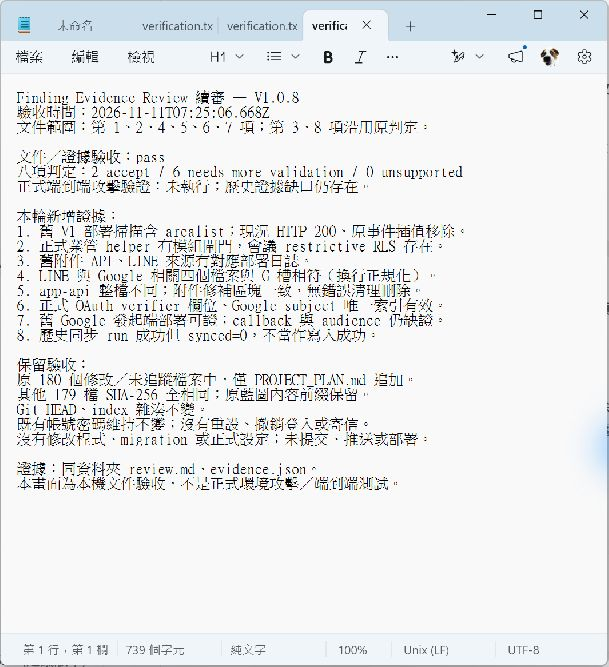

# Finding Evidence Review 續審 — V1.0.8

更新日期：2026-11-11（Asia/Taipei）。文件版本 V1.0.8；本機補記，未提交／推送，不是應用程式發布版號。
範圍：第 1、2、4、5、6、7 項。第 3、8 項沿用使用者接受的判定。既有帳號密碼維持不變。

## 結論與證據邊界

本輪完成唯讀補證，仍為 **2 accept、6 needs more validation、0 unsupported**。accept 是接受原始弱點主張，不是「風險全部消失」；needs more validation 是完整歷史條件尚有缺口，不是「未發現問題」。

獨立讀取 G 槽來源、Git 歷史、既有部署日誌與正式 Supabase 中繼資料，並 GET 一個正式靜態頁面。沒有修改正式設定或資料、執行攻擊載荷、業務表單、LINE 訊息、Google 授權、密碼清查／重設、撤銷登入或寄信；沒有測試、build、提交、推送或部署。僅新增本報告與驗收產物、追加專案藍圖。

G 槽 HEAD 為 3885742bde404b393cea4be229b0f6dd12b69544，工作樹含既有修補，不能將 HEAD 當成現況內容。先前網站發布為 ca5f01c3149d41181776cc5536766bf3c4bf6ee6；本輪後端版本由實際管理 API 讀回。

[evidence.json](evidence.json) 保存本輪選定的查詢回傳、來源比對及去除無關內容的歷史日誌摘錄。沒有保存整份 session、秘密、業務資料或群組識別值。原始完整報告與前輪證據索引位於 [PROJECT_PLAN.md](../../../PROJECT_PLAN.md) 的八項最終審查段落。

| 項次 | 本輪新增的獨立證據 | 尚未解決的核心缺口 | Verdict |
|---|---|---|---|
| 1 | 歷史部署後掃描讀取 V1；目前該頁 200，舊事件插值已移除 | 歷史有效 CSP、跨使用者資料路徑與觸發 | needs more validation |
| 2 | 正式 helper、相依授權函式與業管表 RLS 已含修補 | 歷史完整 grants、入口設定與同帳號市場＋deny 條件 | needs more validation |
| 3 | 本輪未重審 | 既有密碼風險保留 | accept |
| 4 | 修補前 API 部署日誌；目前附件區塊與 G 一致且無錯誤刪除 | 同時期 schema／Storage 與班別、附件前提 | needs more validation |
| 5 | 修補前 LINE 部署與來源；目前兩檔與 G 一致 | 歷史邀群、Webhook／通知啟用及受眾條件 | needs more validation |
| 6 | 正式限制型 RLS 與表 ACL、trigger 讀回 | 歷史入口、欄位授權與有效拒權帳號直連 | needs more validation |
| 7 | 舊發起端部署；目前兩支函式與 G 一致，欄位及唯一索引存在 | 舊 callback 部署、Google audience／受眾及歷史索引 | needs more validation |
| 8 | 本輪未重審 | PNG 格式不等於 OCR 抵抗力完整驗收 | accept |

## 第 1 項 — V1 樓層儲存型 XSS

**Plain-language summary / Claim anatomy**：依使用者確認，當時只有系統管理員能建立／修改樓層。Source 是該管理員可寫的 floor_spaces.floor；Control 是將 HTML escaping 誤用於 JavaScript 字串；Sink 是另一位使用者頁面的 onclick。若另一人讀到同筆資料並點擊，且有效 CSP 允許，名稱可能變成該頁的程式執行。不把此案描述為一般使用者提權或已取得 session。

**Evidence**：
- **Independently Verified，原始來源**：3885742b 的 system/arealist.html:420 仍為 onclick 中的 toggleFloor 字串插值，來源 meta CSP 含 script-src unsafe-inline。來源相同不代表當時 HTTP header 相同。
- **Independently Verified，歷史遠端**：[run 40053489789](https://github.com/jnfakimo/Inspection/actions/runs/40053489789) 於 2026-10-24 02:20:40 UTC 回報 38 頁、4 敏感路徑與簽章通過；EXPECTED_COMMIT 是 3885742b。該提交 tools/scan-all-pages.mjs 列舉 system/*.html，包含 arealist，逐頁要求 HTTP 200、HTML 與來源標記。這補強當次部署後 V1 URL 可讀；不是一般使用者已打開／點擊的證據，也沒記錄完整 CSP headers。該 run 目前 artifacts 列表為空。
- **Independently Verified，目前正式頁**：本輪 GET arealist.html 為 200，回應未見 CSP／CSP-Report-Only header，meta CSP 仍含 unsafe-inline；舊 toggleFloor 行內插值不存在、data-floor-action 存在。只代表本次直連 GitHub Pages 回應，不代表歷史、IIS 或其他代理。
- **Report-Supplied／先前證據**：三份歷史簽署產物與離線 VM PoC 沿用前輪；本輪沒有重跑 PoC。
- **User-Confirmed**：只有系統管理員能寫樓層。**Unknown**：當時接收者權限、有效 CSP 與跨使用者觸發。

**Existing controls and counterevidence**：管理員寫入前提限制攻擊者範圍；G 槽三處模板採資料屬性與事件監聽器，原 sink 已移除。現在 floor_spaces 的讀取 RLS 要求 active_user_id，不能倒推當時實際帳號。CSP 對行內 handler 的規則可參考 [MDN](https://developer.mozilla.org/en-US/docs/Web/HTTP/Reference/Headers/Content-Security-Policy/script-src-attr)。

**Severity and Confidence**：條件式 Medium；來源缺口 High，歷史可達性得到補強，完整歷史可利用性仍不足。
**Coverage**：已看原始模板、當時掃描器、遠端部署紀錄、目前 HTTP 與資料庫政策；未做真實瀏覽器載荷、跨帳號操作或歷史代理重建。
**Proof Gaps / Next validation actions**：先取得同時期的完整回應／HAR／代理設定與去識別化權限證據，以判斷 CSP 是否阻擋及另一使用者能否讀同筆資料。若歷史資料不存在，只能在隔離環境以明示假設重建，不能稱為歷史正式驗證。
**Verdict**：needs more validation。縮小「V1 是否曾可讀」缺口，但沒有補齊跨使用者與歷史 CSP；不證明曾被利用，也不推翻原始程式缺陷。

## 第 2 項 — 業管交接 RPC／RLS 忽略模組拒絕

**Plain-language summary / Claim anatomy**：有效且具市場資格、但被拒絕業管模組的帳號，可能直接呼叫資料入口。Source 是該帳號的 REST／RPC；Control 是舊 business_market_allowed 僅檢查市場資格；Sink 是同市場交接資料。不是匿名或任意跨市場存取。

**Evidence**：
- **Independently Verified，原始來源**：3885742b 的 20260916132000_business_handover_market.sql:18–22 未檢查模組；原 Edge handler 有模組閘門，原主張限繞過該入口直接進資料層。
- **Independently Verified，現況**：正式 pg_get_functiondef 讀回 helper 已要求 active_user_id 非空及 has_handover_module_access('business')，再檢查市場；相依函式到 has_module_access，個人／角色 deny 會參與判定。authenticated 可執行 helper。
- **Independently Verified，現況**：四個 business_handover 表啟用且強制 RLS；相關政策引用 business_market_allowed，表 ACL 與政策詳見 evidence.json。這是目前設定，不是原始時點完整 grants。
- **Report-Supplied／先前證據**：歷史 helper 回傳與拒權測試沿用前輪；該 deniedUser 案例未保存同一帳號市場資格，不升格成完整重現。
- **User-Confirmed**：先前保留待補證。**Unknown**：原時點入口設定及同帳號有效身分、市場資格與 deny 的交集。

**Existing controls and counterevidence**：active_user_id 另要求 active profile 及 security_session_allowed；Edge 與市場邊界仍有效。管理查詢會話的 pgrst.db_schemas／db_pre_request 均為 NULL，**不能解讀為正式 PostgREST 沒有前置檢查或沒有暴露 schema**。
**Severity and Confidence**：Medium；原始程式缺口 High，歷史完整鏈仍需驗證。
**Coverage**：來源、正式函式定義、RLS／ACL；未讀人員／交接資料，未登入或經 JWT 操作 REST。
**Proof Gaps / Next validation actions**：補原時點完整 RPC／表／欄位 grants、API 暴露／前置檢查設定，以及去識別化同帳號資格證據。現況負向測試可另在隔離庫用「市場資格成立＋模組 deny」案例做真 JWT 驗證，避免拒絕原因混淆。
**Verdict**：needs more validation。目前修補在資料庫已存在，但不能用現況 ACL 或單一 SQL deny 結果補成歷史可利用性。Grants 與 RLS 是不同層控制，參見 [Supabase 官方說明](https://supabase.com/docs/guides/api/securing-your-api)。

## 第 4 項 — 附件錯誤清理刪除既有物件

**Plain-language summary / Claim anatomy**：具駐警交接與市場權限者，把既有附件路徑配上可提交班別。Source 是 path／班別組合；Control 只按提交班別檢查鎖定，未把 path 綁定班別；Sink 是索引新增失敗後以服務權限 Storage.remove，可能刪掉已簽附件的實體物件。

**Evidence**：
- **Independently Verified，歷史遠端＋來源**：[run 40471340612](https://github.com/jnfakimo/Inspection/actions/runs/40471340612) checkout c3fcd8e2ff1b1cf7b9630823a0efddbe5b96c51f，2026-10-27 08:09:55 UTC 回報 app-api 部署至同一正式專案；Git 該版仍有大小超限／索引失敗兩處 Storage.remove。這是部署命令成功與 Git 來源鏈，不是舊 Edge bundle 逐 byte 讀回。
- **Independently Verified，現況**：正式 app-api version 127 的相關區塊（部署來源 4193–4220；G 槽 4197–4224）正規化換行後完全一致，兩處失敗直接回應且無 remove。
- **Independently Verified，現況**：storage_path 唯一索引有效，附件表有保護 trigger、RLS／FORCE RLS。
- **重要差異**：app-api 整檔與 G 槽不相同；第一處差異涉及其他班別處理的索引註解。此處只聲稱附件相關區塊一致，沒有審查或覆寫其他差異。
- **Report-Supplied／先前證據**：既有 mock 回歸只支持分支行為。**Unknown**：原時點 Storage／schema 與符合前提的附件、班別組合。

**Existing controls and counterevidence**：已簽班別／當日主管簽核會拒絕；不是跨市場任意刪檔。資料表保護 trigger 不等同 Storage 物件刪除控制。修補後錯誤分支已不做實體刪除。
**Severity and Confidence**：Medium；程式機制 High，部署來源證據增加，完整歷史鏈 Medium。
**Coverage**：部署日誌、歷史／目前處理區塊、現況索引與 trigger；沒有讀附件內容、請求 signed URL、上傳或刪除物件。
**Proof Gaps / Next validation actions**：取得同時期 schema、Storage 設定及去識別化的「既有附件＋另一可提交班別」證據；必要時在拋棄式隔離 Storage，用合成物件重現舊錯誤與新物件保留。不能在正式庫對既有附件試刪。
**Verdict**：needs more validation。已補強舊 API 曾部署，但缺少同時期完整前提；不要求先證明真實刪檔事故，亦不把 mock 當成事故證據。

## 第 5 項 — LINE 群組事件覆寫共用通知目的地

**Plain-language summary / Claim anatomy**：若攻擊者能把 bot 加入未核准群組，合法 LINE 群組事件可能改寫共用通知目的地。Source 是已簽章的 groupId；Control 把來源驗證誤當成收訊群組授權；Sink 是 system_settings.line_group_id，影響使用該設定的群組推播。

**Evidence**：
- **Independently Verified，歷史遠端＋來源**：[run 40046791041](https://github.com/jnfakimo/Inspection/actions/runs/40046791041) 以 453d968d7a03db379a5c3e5942f2b3a76a0961d3 回報 line-notify 部署；其兩個相關來源與 3885742b 無差異，共用 handler 仍收集 groupIds 並逐一 saveGroupId。更早 [run 38829266322](https://github.com/jnfakimo/Inspection/actions/runs/38829266322) 也留下 line-notify 部署行。未取得舊 bundle 完整讀回。
- **Independently Verified，現況**：line-notify version 34 的入口與共用 vehicle-line-webhook 檔，與 G 槽正規化換行後完全一致；一般群組事件不再呼叫 saveGroupId。型別介面保留此名稱不是執行證據。
- **Report-Supplied／先前證據**：設定曾存在及「測試成功」摘要不足以證明未核准群組可加入／實際收訊。
- **Unknown**：當時 bot 邀群設定、Webhook 啟用／端點對應、共用推播啟用與可控制群組條件；沒有使用者新確認。

**Existing controls and counterevidence**：HMAC 驗證仍存在，攻擊者不能任意偽造事件；個人通知與其他目的地不因此全部受影響。現況受影響自動寫入路徑已移除。
**Severity and Confidence**：Medium；程式機制 High，歷史部署證據增加，完整鏈 Medium。
**Coverage**：只讀來源與部署資訊，沒有讀取 channel secret、群組 ID／成員訊息、呼叫 webhook 或推播。
**Proof Gaps / Next validation actions**：先取得當時 LINE 控制台非秘密設定匯出及通知啟用紀錄；事件→設定異動→推播回應只用於進一步確認實際影響／事故，不是漏洞成立必須有既發事故。隔離重建應使用測試 bot 與明確同意的測試群組，未在本輪執行。
**Verdict**：needs more validation。修補前部署證據增加，但無法判斷當時攻擊者能否滿足邀群及收訊條件。

## 第 6 項 — 會議預約 RLS 忽略模組拒絕

**Plain-language summary / Claim anatomy**：有效但被拒絕會議權限者，可能直接經 REST 讀取預約或修改本人預約。Source 是 authenticated 請求；Control 是舊 SELECT 只驗 active 身分，INSERT／UPDATE 只驗本人或管理員；Sink 是 meeting_bookings。

**Evidence**：
- **Independently Verified，原始來源**：3885742b 的 non_admin_bulk_read_cutoff migration 與先前政策封存支持舊讀取條件；應用 handler 自身有模組判斷，主張限定直接資料入口。
- **Independently Verified，現況**：正式 meeting_bookings 啟用 RLS／FORCE RLS，meeting_bookings_module_gate 是 RESTRICTIVE／ALL／authenticated，USING 與 WITH CHECK 皆要求 active_user_id 及 has_module_access('meetingroom','bookings')；原 owner/admin 政策仍在。
- **Independently Verified，現況**：authenticated 有表 ACL；原日期輸入與 Calendar 欄位保護 trigger 仍在。這些不是歷史欄位 ACL 的替代品。
- **Report-Supplied／先前證據**：前輪 deniedUser 是業管案例；無身分 0 筆與管理員 8 筆不證明會議 deny 案例。
- **Unknown**：修補前表／欄位 grants、暴露／前置授權與同時具有效工作階段的會議拒權帳號。

**Existing controls and counterevidence**：本人／管理員及日期／Calendar trigger 縮小可寫範圍；不主張任意修改他人資料或 DELETE。管理會話的 pgrst 設定 NULL 不能當作資料入口無防線。
**Severity and Confidence**：Medium；原始 RLS 缺口 High，完整 REST 鏈 Medium。
**Coverage**：來源及正式政策／ACL／trigger；未讀預約、冒用 JWT、建立或修改預約。
**Proof Gaps / Next validation actions**：補同時期 ACL／入口設定；隔離測試要用 active、session-valid、meeting deny 的專用測試帳號，明確驗證指定欄位讀取與本人預約寫入，不用 count(*) 或業管 deny 代替。隔離結果不自動證明歷史正式設定。
**Verdict**：needs more validation。現況限制型政策確實存在；歷史直接入口與帳號前提仍缺證據。

## 第 7 項 — Google OAuth 帳號錯誤連結

**Plain-language summary / Claim anatomy**：有效系統帳號發起 OAuth 後分享授權網址，符合 Google 受眾的另一人於十分鐘內用相同 UA 同意。Source 是該合法交易／受害者同意；Control 只有 state、PKCE、UA，未綁回呼當下使用者／瀏覽器秘密；Sink 是用發起者 user_id 寫入 Google 連結及後續行事曆同步。

**Evidence**：
- **Independently Verified，歷史來源**：3885742b callback:35–53 消耗 state、比對 UA 後交換 token 並以 stateRow.user_id 寫連結。state／PKCE 本身有效，不能稱為偽造 state 或無互動接管。
- **Independently Verified，歷史遠端**：[run 32865903745](https://github.com/jnfakimo/Inspection/actions/runs/32865903745) 於 2026-08-25 回報 google-calendar 發起端部署；該 c837d982 與 3885742b 的相關兩檔無差異。但該 run 只部署 google-calendar，**不能同時證明 callback 部署**。針對最初 commit 與 8 月 18–19 日的現有工作流查詢未回傳 run，不推論「從未部署」。
- **Independently Verified，歷史同步反證**：[run 40468830432](https://github.com/jnfakimo/Inspection/actions/runs/40468830432) 於 2026-10-27 回傳 processed=0、synced=0、failed=0、skipped=0。工作流成功在此只表示無工作處理，沒有證明行事曆已寫入。
- **Independently Verified，現況**：google-calendar version 16 與 callback version 15 原始碼均與 G 槽正規化換行後一致；finish 同時核對 user_id、state、browser verifier、期限並原子消耗。callback 只轉回前端，不交換 token／寫連結。正式 browser_verifier_hash 欄位存在；google_subject partial unique index 有效，條件只排除 NULL，沒有 status 限制。
- **Unknown**：舊 callback 精確部署、當時 Google audience／Testing／Production／測試使用者與組織限制、歷史唯一索引。未取得新的使用者設定確認。

**Existing controls and counterevidence**：需受害者互動、合法 Google 設定、UA／TTL 相符；已被其他紀錄占用的 Google subject 若索引有效會遭拒，包含非 active 紀錄。不能推定 raw token 洩露或任意讀取全部行事曆。現況 refresh-token 重用另要求同 Google subject。
**Severity and Confidence**：Low；原始程式缺口 High，完整歷史可利用性 Medium。
**Coverage**：歷史／現況來源、部署日誌、目前 schema／索引；未操作 Google 授權、存取憑證或行事曆資料。
**Proof Gaps / Next validation actions**：先找 callback 部署與 Google 非秘密設定封存；如要測目前防線，使用隔離 OAuth client／雙方測試帳號與空白行事曆，分開驗證錯誤帳號、錯誤 verifier、逾期、重放及正常路徑。仍須另證歷史受眾設定，不能以隔離成功代替。
**Verdict**：needs more validation。補上發起端部署及目前修補證據；callback 與受眾條件仍未充分證實。

## 收尾與下一步

六項繼續保留原判定，無須為了得到 accept 而在正式環境製造事件。下一個會改變結論的工作，是取得同時期的設定封存；若不存在，應明確標為無法判斷歷史狀態，再以隔離環境驗證「條件成立時」的可利用性與修補效果，分開出具結果。

本輪沒有證明曾發生外洩、刪檔或錯誤 OAuth 綁定；缺乏事故紀錄亦不等於弱點不存在。現況定義／部署來源已核對，不等於負向權限或第三方端到端測試完成。

[文件驗收](verification.txt) · [中繼資料與日誌摘錄](evidence.json)

下圖是本機記事本顯示本輪驗收紀錄的真實擷取；不是正式攻擊測試畫面，也不是 GitHub／Supabase 控制台截圖。

