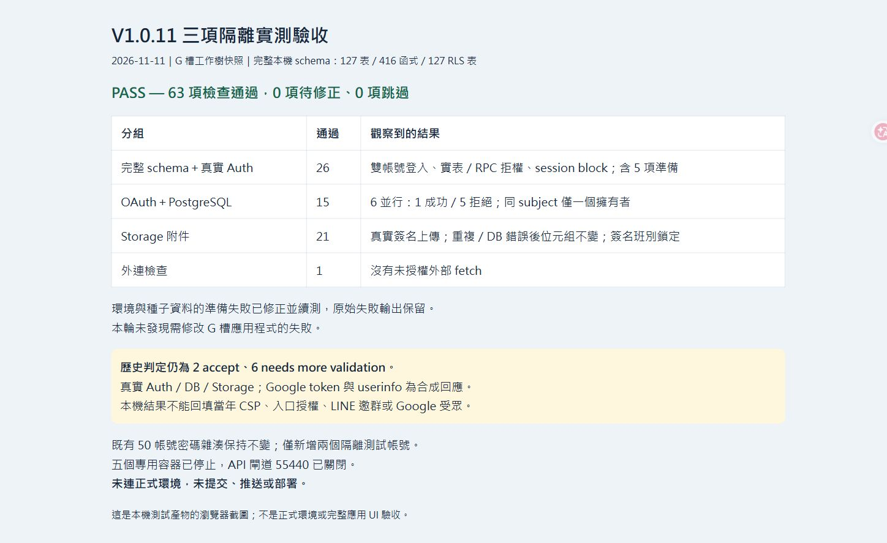

# V1.0.11 完整 schema、真實 Auth、OAuth 並行及 Storage 隔離驗收

更新日期：2026-11-11。文件版本 V1.0.11；不是應用發布版號。結果：**pass（本報告限定的隔離驗證範圍）**。

## 範圍及環境

G 槽原始碼正本為 `G:/我的雲端硬碟/AI/Codex/北農巡檢系統`，HEAD `3885742bde404b393cea4be229b0f6dd12b69544`；使用當時工作樹快照，包含既有修補，並非僅 HEAD。完整函式／migration 位元組比對見 source-manifest.json。隔離工作區為 `C:\projects\Inspection-isolated-v111-20261111`。

從本機既有合成資料 Supabase 複製完整資料庫至全新 internal Docker network，127 張 public 表、416 個 public 函式、127 張 RLS 表。既有本機 50 個 Auth 帳號雜湊保持一致，另建立兩個專用合成帳號，使用真實 GoTrue 密碼登入及 auth.sessions。沒有從正式環境下載資料。只在副本套用未修改的 20261106050736_codex_security_boundary_fixes.sql。排除 pg_cron，既有 Storage 位元組未複製；附件測試均使用新上傳合成檔案。

PostgreSQL 17.11、GoTrue 2.197.0、PostgREST 16.5、Storage 1.84.19。Windows 僅開 127.0.0.1:55440 測試閘道，透過 WSL 私網轉送至四個專用容器；internal network 不因轉送而解除。實際 G 處理程式以 Node/esbuild Deno 相容層執行，使用真實 supabase-js；只有 Google token／userinfo 是合成回應，其餘未列入白名單的外部 fetch 一律拒絕。

## 實際完成結果

| 分組 | 通過 | 實測證據 |
|---|---:|---|
| Auth／資料準備／完整權限 | 26 | 5 項準備＋21 項權限：真實密碼登入、持久化 session、active_user_id；A/B 同市場資格而模組 allow/deny；會議實表讀寫、本人／他人界線、業管實表與 SECURITY DEFINER RPC、跨市場拒權、session block、匿名拒絕 |
| OAuth／PostgreSQL | 15 | 錯帳號及錯 verifier 拒絕且 state 保留；6 個同時 finish 得 1×200、5×400，DB state 消耗一次、provider exchange 一次；兩個不同帳號同時連相同 subject，1×200、1×400，唯一擁有者；disconnected 列仍受唯一索引保護 |
| Storage／附件 | 21 | 真實 signed upload、下載 SHA256 一致、正常 commit；跨班別相同 path 觸發唯一索引 409；限定合成 incident 的 DB fault trigger 觸發 42501 後 API 409；兩種失敗均保留物件位元組；模組拒權、跨市場拒權、宣告超限拒絕、合法 draft→submitted 後附件鎖定；fault trigger 清除 |
| 外連阻擋檢查 | 1 | 處理程式未嘗試未授權外部 fetch |
| 合計 | **63** | 最終待驗條件 0 fail、0 skip；另有環境／密碼及文件保留檢查 |

實際索引與 36 筆表 grants 收於 final-environment-audit.json。google_subject 唯一索引為非 NULL 條件式索引，不以 status='active' 為條件；storage_path 全表唯一索引有效。測試比較的是完整本機 schema 上的行為，未替換 active_user_id、session gate 或 business table 成最小模型。

## 失敗、修正與續測紀錄

沒有發現需要新增 G 槽程式修補的測試失敗。準備環境時修正了 PostgreSQL 角色／grantor 還原順序與 internal network 的本機轉送。完整 schema 正確擋下缺主管、缺聯絡電話、沒有真實登入 actor 的測試種子；改由合法資料與真實 Auth REST 建立，未停用原觸發器／RLS。

第一段在 Auth／OAuth 41 項通過後，Storage 因只有每日班表、沒有班別範本而得到 404；原始 fail 輸出保留在 auth-oauth-with-storage-setup-failure.json。補建隔離班別範本後，Storage 前 13 項通過；接著直接插入 submitted 測試資料被 DB 正確拒絕，原始失敗保留在 storage.json。續測腳本使用合法 draft→submitted 狀態轉換與合格接班人，通過剩餘 8 項及 1 項外連檢查，見 storage-final.json。補寫續測腳本時修正附件時間欄位名稱為 uploaded_at。

validation-summary.json 只將已對應修正並通過的條件納入最終 63 項；沒有將原始失敗覆寫成成功。已通過且未受改動影響的 Auth／OAuth 未重跑。scripts 目錄保存各次實際執行腳本，因此前兩支歷史腳本仍會在上述準備點停止，不能把它們當成全綠的單支 CI 腳本；執行順序及依賴是 clone-local → local-gateway → run-integration → run-storage → run-storage-final → final-audit。重現需全新隔離副本，不能對正式庫使用。

## 與原八項 Finding Evidence Review 的關係

| 原項目 | 本輪補強 | 歷史判定／仍缺 |
|---|---|---|
| #2 業管、#6 會議權限 | 完整本機 schema＋真實 Auth 雙帳號、實表、RPC 與 session 負向／正向控制 | needs more validation；當年完整 grants、入口前置授權、拒權帳號同時成立條件仍缺 |
| #4 附件 | 真實 Storage 物件與 DB 索引失敗後不刪檔、權限／簽名班別界線 | needs more validation；修補前 Storage 設定、可利用的歷史班別／附件條件仍缺 |
| #7 OAuth | 真實 PostgreSQL 的 state 並行與 subject 唯一索引 | needs more validation；歷史 audience、callback／索引封存未補齊；Google 授權／同步未實測 |
| #1、#5 | 本輪未新增驗證 | needs more validation；歷史 CSP、跨使用者條件與 LINE 邀群／通知路徑仍缺 |
| #3、#8 | 沿用既有 accept，未重審 | 既有帳號密碼維持不變，第 3 項殘留風險不消失 |

總判定仍為 **2 accept、6 needs more validation**。目前修補在隔離環境通過，不能回填歷史可利用性。

## 保留、清理與未涵蓋範圍

既有帳號密碼維持不變。原本機 50 個帳號與複製後 50 個帳號的密碼雜湊均與開工一致；測試只使用新建兩個合成帳號。未連正式環境，未操作 Google 真實授權、LINE、寄信；未提交、推送、合併或部署。G 槽應用程式零變更，只追加藍圖與本資料夾。

四個 v2 容器及首輪未成功 clone 容器均已停止；55440 閘道已關閉，專用 WSL keepalive 已停止。保留私有測試 dump／credentials 於 C 槽 .local，不納入本報告或 G 槽。原本地服務未改設定、未停用。

本輪沒有驗證正式 schema 與此完整本機 schema 完全相同、完整應用 UI、正式 Edge runtime、外部 Google OAuth／Calendar 同步、實際大於 50 MiB 物件的 commit 分支或長時間負載競爭。超限案例只驗證宣告大小拒絕；這些限制不應被 63 項通過掩蓋。CI／CodeQL、build、正式／設備／備援驗收均未執行。

截圖為瀏覽器呈現機器可讀測試結果的本機驗收摘要，不是正式環境、歷史畫面或完整 UI E2E。詳細雜湊與保留驗收見 verification.txt。
