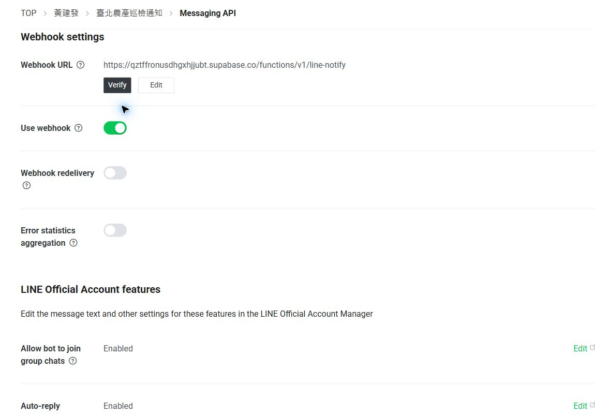
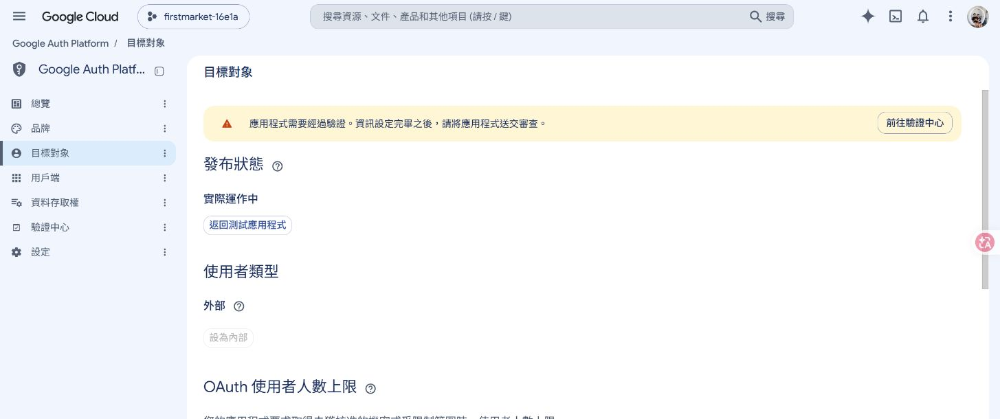

# Finding Evidence Review 歷史設定補證 — V1.0.9

更新日期：2026-11-11（Asia/Taipei）。文件版本 V1.0.9，本機補記，未提交／推送；不是應用發布版本。
範圍：歷史 CSP、完整權限／入口設定、LINE 邀群條件、Google 授權受眾設定。沿用 [V1.0.8 六項續審](../2026-11-11-finding-evidence-followup/review.md) 的原始主張、修補證據與其他缺口；本報告只補新證據，不取代原報告。

## 審查結果

**仍為 2 accept（第 3、8 項）、6 needs more validation（第 1、2、4、5、6、7 項）。** 本輪確實取得歷史日誌及目前控制台設定，但沒有補齊原時點的完整條件。accept 指接受弱點主張，不代表風險消失；needs more validation 不等於無漏洞。

本輪使用本機 Git／封存與唯讀管理查詢、LINE Developers、Google Cloud 控制台。使用者完成 LINE 登入後繼續讀取設定，沒有按 Verify、編輯、切換設定、邀群、發訊、執行 Google OAuth 授權或操作行事曆。未修改程式、資料庫／平台設定或既有帳號密碼；未提交、推送、合併或部署。僅新增本目錄及追加 PROJECT_PLAN.md。此為證據核對，不是正式環境攻擊重現或負向權限驗收。

| 證據面 | 本輪獨立確認 | 未補齊的歷史條件 |
|---|---|---|
| CSP／第 1 項 | 有本機 IIS 模板；前輪舊部署掃描曾讀取 V1 | 同時期有效 HTTP CSP、其他代理與跨使用者觸發 |
| 權限入口／第 2、6 項 | 目前 5 表、198 筆欄位權限、22 支相關函式授權；修補前 4 筆 REST 200 | 歷史完整 grants、gateway 設定、有效且被拒權帳號；4 筆都是伺服器金鑰 |
| LINE／第 5 項 | 目前邀群與 Webhook 啟用，端點對應；歷史 4 筆管理端設定稽核 | 修補前邀群開關、可控制群組及推播啟用條件 |
| Google／第 7 項 | 目前外部／實際運作中；歷史 6 筆 OAuth 設定事件 | 事件沒有歷史 audience／publishing／test users 值，舊 callback 與索引仍缺 |

## 1. 歷史 CSP

**原始證據**：V1.0.8 已將 2026-10-24 部署 run 40053489789 與原始提交 3885742b 的 arealist 掃描邏輯連結；HTTP 200 支持該次 URL 可達，不代表另一使用者執行 onclick，也未保留 HTTP headers。原始 meta CSP 含 unsafe-inline，不能排除額外 HTTP CSP 造成更嚴格限制。使用者確認當時僅系統管理員可建立／修改樓層。

**本輪補查**：針對 G 專案與 C 槽既有安全稽核／Pages 發布封存查找 header、HAR、代理與 CSP 相關產物，找到 tools/selfhosted-iis-supabase-proxy.web.config 等模板，未找到可連到原時點有效回應的完整 header／HAR。Internet Archive 對指定 arealist URL、截至 2026-11-05 的 CDX 查詢回傳空陣列。這些結果只描述查詢範圍，不能證明全世界不存在封存或當時沒有 CSP。

**修補後對照**：沿用 V1.0.8 已核對的資料屬性＋事件監聽器及原 sink 移除；本輪未重跑 XSS。現在的 HTTP 回應／模板不倒推歷史。

**判定**：needs more validation。條件式 Medium；原始程式缺陷證據強，跨使用者與歷史有效 CSP 無法判斷。最小缺口是原時點帶日期與部署識別的回應／代理設定，以及另一使用者能讀同筆資料的權限證據。

## 2. 完整權限與資料入口

**目前觀察，非歷史復原**：以唯讀 catalog 查詢取得 4 張 business_handover 表及 meeting_bookings 對 anon／authenticated 的 10 組表權限、198 筆欄位權限紀錄、22 支指定業管／授權函式簽章、EXECUTE 與 SECURITY DEFINER 中繼資料。完整選定範圍結果見 [evidence.json](evidence.json)。

- 5 表均啟用 RLS／FORCE RLS；anon 的 SELECT／INSERT／UPDATE／DELETE 表權限均為 false。
- authenticated 對 approvals、entries、meeting_bookings 有上述 4 種表權限；completions、transfers 僅 SELECT。表 grant 不是繞過 RLS，也不代表沒有 trigger／欄位限制。
- 22 支函式的 anon EXECUTE 全 false；authenticated 可執行 12 支。這是選定函式清單，不能稱為全部資料庫或完整歷史呼叫圖已審完。
- pg_db_role_setting 中指定 pgrst.db_schemas、pgrst.db_pre_request、pgrst.db_extra_search_path 查詢為空。**設定可能來自外部 gateway，因此仍無法判斷完整暴露／前置授權設定。** 不能將空結果當成沒有前置防線。
- 本輪未冒用 JWT、登入拒權帳號或實際讀寫交接簿／預約。現況 RLS 函式及模組限制沿用 V1.0.8 已讀回證據；未宣稱端到端驗收。

**新增修補前日誌**：查詢範圍嚴格為 2026-11-05 00:00 UTC（臺灣 08:00）至 2026-11-06 00:00 UTC（臺灣 08:00），不是臺灣曆日整天。該區間可見 postgres_logs 1177、edge_logs 3908、function_edge_logs 700 筆。針對 meeting_bookings 的 4 筆 GET HTTP 200，進一步確認均使用伺服器／secret key 類型，沒有 auth_user，JWT role 欄位為空，content_range 為 */*。

這是「有伺服器請求抵達 REST 路徑」的證據，**不是 anon／authenticated 拒權使用者可存取的證據，亦不證明回應有資料列**。JWT role 空白不能解讀為 anon。業管指定 REST／RPC 前綴在這段範圍沒有匹配，不能推論入口不存在。指定 PostgreSQL 篩選只有 BIND 4、SELECT 22，沒有足以還原 grants 的完整 DDL 歷程。

**既有備份界線**：找到 [2026-11-05 備份 run 42127566613](https://github.com/jnfakimo/Inspection/actions/runs/42127566613) 的未過期加密產物（artifact 13463026786，108128521 bytes）。在該 run 的 a8e088423927ba9f9074912658268b1f9643b799 來源，tools/database-backup.mjs 與 docs/DATABASE_BACKUP_RECOVERY.md 明載 row NDJSON／Storage 備份，schema／RLS 不在內，auth_users=false、database_roles=false。未下載／解密，不能以其存在宣稱可還原歷史 ACL 或備援驗收成功。本機 _pgbackup 是 Pinegrow 設定資料夾，並非 PostgreSQL dump。

**判定**：第 2、6 項維持 needs more validation（Medium）。新證據沒有補足歷史完整表／欄位／RPC grants、實際 gateway 暴露及同帳號 active＋session-valid＋模組 deny（第 2 項另需市場資格）的交集。第 4 項 schema／Storage 與班別附件缺口本輪未獲新證據，判定不變。下一步需同時期 ACL／gateway 匯出或設定異動版本；若無封存，只能另行用合成資料在隔離環境驗證條件式行為，不得稱為歷史正式重現。

## 3. LINE 邀群與 Webhook

**目前獨立確認**：LINE Developers 的「臺北農產巡檢通知」（channel 2010493763）顯示 Allow bot to join group chats = Enabled、Use webhook = 開啟。Webhook URL 對應正式專案的 /functions/v1/line-notify。Webhook redelivery 與 Error statistics aggregation 均關閉。只看非秘密設定，未讀 Channel secret／access token，未按 Verify 或變更任何開關。

[LINE 官方群組說明](https://developers.line.biz/en/docs/messaging-api/group-chats/) 說明允許加入群組開關與邀請條件，一個群組同時最多一個官方帳號。這支持設定意義，但不證明當年的開關值、特定攻擊者可邀請，或群組已有官方帳號時仍能加入。

**歷史紀錄**：audit_logs 中以 system_settings 及 line_group_id 鍵名／changes 提及篩選，2026-11-06 UTC 前有 4 筆 update，來源 v2-admin，operator 非空；最早 2026-08-25 15:42:27.259303 UTC、最晚 2026-08-26 04:36:59.539469 UTC。未取群組 ID、訊息內容或操作者身分。這些只能證明管理端稽核提及該鍵，不能宣稱 4 次目的地實值改變，更不能當成未核准 Webhook 接管。

上述 24 小時 function 日誌沒有匹配 line-notify function ID。初次按 request.path 篩選因該欄位空而無法使用，已改按 function ID 查核；結果缺席仍不能證明歷史從未有事件。控制台所見介面未提供可證明修補前邀群值的變更歷程。

**修補後對照與反證**：V1.0.8 已核對正式 version 34 與 G 的相關兩檔一致，事件自動 saveGroupId 路徑已移除；目前允許邀群本身不是原弱點仍存在。HMAC 驗證不等於目的地授權，兩者分開。

**判定**：第 5 項 needs more validation（Medium）。目前設定缺口已補；歷史開關、可控制群組及共用推播啟用條件仍無法判斷。要改判需同時期非秘密設定匯出／可靠變更紀錄；若進一步查實際影響，可用去識別化事件與目的地異動關聯，不要求先有事故才能成立漏洞。

## 4. Google 受眾與歷史設定事件

**目標對應**：Google Cloud 專案 firstmarket-16e1a，Web client「臺北農產會議室預約系統」，client ID 與 callback URL 已核對為本案 Supabase 專案。沒有讀 client secret、切換發布狀態或執行授權／token 交換。

**目前獨立確認**：目標對象頁顯示「外部」及「實際運作中」，並有需完成驗證的提示。OAuth 使用者為 1／上限 100，**這是使用量，不是只允許 1 名測試使用者的名單**。[Google 官方受眾說明](https://support.google.com/cloud/answer/15549945?hl=en) 區分 Testing 與 Production；實際能否授權仍可能受驗證、配額、帳號及組織政策限制，不宣稱任何帳號一定成功。

**新增真實歷史證據**：Logs Explorer 使用明確 timestamp 範圍 2026-08-18T00:00:00Z 至 2026-11-06T00:00:00Z，serviceName 匹配 oauth／authconfig，取得 6 筆 clientauthconfig.googleapis.com 事件，均在 8 月 18 日：CreateBrand 1、CreateClient 1、AddClientSecret 1、UpdateClientSecret 1、UpdateBrandWithMask 2。未展開秘密建立／更新事件。

只展開兩筆 UpdateBrandWithMask 的 request／response：
- 2026-08-18T03:50:33.451618Z，insertId nxe5q3d3dec。
- 2026-08-18T03:59:36.630527Z，insertId nxe5q3d3dmu。

可見 type、brandId 與 supportEmail；request／response **沒有 audience、publishing status、test users 或 update-mask 具體值**。保存去除郵件地址的 [第一筆摘錄](google-brand-audit-second-redacted.txt) 與 [第二筆摘錄](google-brand-audit-redacted.txt)。其餘收合中繼欄位未展開，不把畫面摘錄稱為完整原始日誌。事件存在支持「當時曾修改品牌設定」，不能推論「當時已發布」或修改的具體欄位。

本機舊工作摘要曾記載 8 月 18 日加入一名測試使用者，但所指原始 session 檔目前不存在；只作 Report-Supplied／次級線索，不能證明當時只限該人或完整發布歷程。此摘要可能不完整，不升格為本輪獨立驗證。

修補前 11 月 5 日 function 日誌顯示 google-calendar version 14 有 6 筆 HTTP 200；沒有相符 callback 日誌。這只補發起端運作證據，不能證明舊 callback、授權完成、行事曆已寫入或受害者條件成立。

**修補後對照與判定**：V1.0.8 已讀回 browser verifier、finish 身分核對與有效唯一索引。本輪未重跑 OAuth。第 7 項維持 needs more validation（Low）：原始錯誤連結程式主張與目前修補分開；歷史 audience 值、舊 callback 精確部署、當時索引與受眾資格仍未充分證實。最小下一步是同時期 consent 設定快照／實際包含受眾值的異動匯出，再與 callback 及索引時點交叉核對。

## 驗收與保留事項

本輪是有限範圍補證，不能宣稱四個歷史缺口全部關閉、無漏洞或從未發生事故。沒有新應用測試、build、資安掃描、正式負向測試或第三方端到端驗收。既有帳號密碼維持不變，第 3 項的使用者決策與殘留風險保留。

兩張圖是 2026-11-11 直接擷取的管理控制台現況；不是歷史畫面，也不是攻擊重現。截圖時間／雜湊見 [capture.json](capture.json)，文件完整性與保留檢查見 [verification.txt](verification.txt)。

