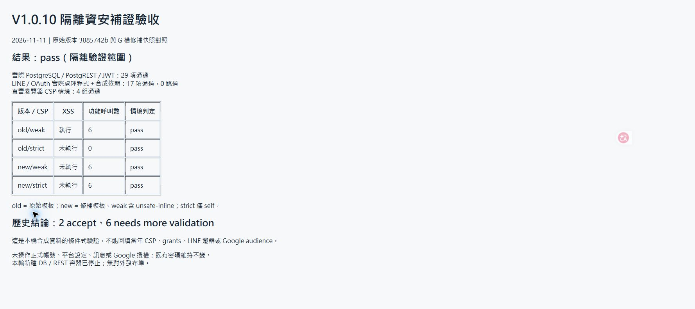

# Finding Evidence Review 隔離邊界補證 — V1.0.10

更新日期：2026-11-11（Asia/Taipei）。V1.0.10 是審查／驗證文件版本，僅本機產物，未提交／推送／部署；不新增應用程式版號。

## 結果與判定

**隔離驗證 pass；歷史缺口尚未全部補齊。** 本輪新增可重跑的驗證腳本與證據，原始版本與 G 槽修補版本的差異在指定條件下得到實測支持。沒有發現需要再次修改本輪受測應用程式的失敗；未將條件式重現改寫成正式環境歷史事實。

- PostgreSQL 17.11／PostgREST 16.5 真實 HTTP 與 JWT 驗證：29 項檢查通過。
- LINE／Google OAuth 實際處理程式搭配合成依賴：17 項測試通過，0 fail、0 skipped。
- Edge 真實瀏覽器：原始／修補模板 × 寬鬆／嚴格 CSP，4 組情境通過。

八項原始 Finding Evidence Review 仍是 **2 accept（3、8）、6 needs more validation（1、2、4、5、6、7）**。本輪關閉的是選定隔離條件的驗證缺口，不是缺失的歷史平台設定。完整原主張、嚴重度與修補現況沿用 [V1.0.8](../2026-11-11-finding-evidence-followup/review.md)；實際控制台與歷史紀錄沿用 [V1.0.9](../2026-11-11-historical-settings-review/review.md)，沒有把它們重標為本輪查詢。

## 來源與隔離環境

- 原始來源：Git 3885742bde404b393cea4be229b0f6dd12b69544 的 LINE、Google 與 V1 arealist，以 git archive 取得。
- 目前來源：G 槽未提交修補工作樹的相關程式、授權 migration 與既有測試，逐檔複製到 C 槽。不能把 G 的 HEAD 當作未提交修補內容。
- 隔離目錄：C:\projects\Inspection-evidence-v110-20261111。只使用既有依賴，沒有安裝套件、載入正式憑證或複製業務資料。
- 資料庫使用專用 WSL Inspection-test 內新建容器；獨立 internal network、無發布埠，沒有連接既有測試資料庫或正式資料庫。PostgREST 的 public schema、無 pre-request、fixture grants 是本輪明示的測試配置。
- WSL 原先為 Stopped，查核時啟動，既有自動啟動容器隨之運作；未修改其設定。本輪新增的 DB／REST 容器已停止，保留測試現場；沒有終止其他既有服務。
- 前端測試僅開啟 127.0.0.1:8774，來源標記與六個控制項從實際 arealist 模板抽取。這不是整個應用頁面或登入／跨使用者資料讀取流程。
- [source-sha256.json](source-sha256.json) 保存測試來源快照雜湊；[artifact-sha256.json](artifact-sha256.json) 保存本輪腳本及結果雜湊。未保存 access token、秘密、帳號資料或正式群組識別值。

## 1. XSS 與 CSP 的真實瀏覽器對照

使用相同合成樓層文字，點擊實際抽取的標題、上一頁及下一頁控制項。一般文字與特殊文字各三個控制項，皆透過瀏覽器點擊。測試旗標僅設於本機頁面，沒有外傳或業務操作。

| 模板 | HTTP CSP | 注入旗標 | 功能呼叫 | 結論 |
|---|---|---|---|---|
| 原始 | script-src self + unsafe-inline | 執行 | 6 次，特殊文字遭當成程式 | 條件式原始缺陷重現 |
| 原始 | script-src self | 未執行 | 0 次，原本行內正常操作亦被擋 | 嚴格 CSP 是本情境反證 |
| 修補 | script-src self + unsafe-inline | 未執行 | 6 次，特殊文字原樣傳入 | 修補阻斷事件插值 |
| 修補 | script-src self | 未執行 | 6 次，特殊文字原樣傳入 | 正常操作不依賴行內事件 |

[實測結果](browser-csp.json) 與 [本機實際 HTTP header](browser-csp-http-header.json) 分開保存。全站 CSP 同時含其他來源時的相容性、實際資料讀取、管理員與另一人的共享資料路徑不在本測試內。

**驗證腳本修正**：首輪要求 securitypolicyviolation 事件數至少 6，但瀏覽器回傳計數 0，雖然所有原始行內控制項均未執行。保留 [首輪輸出](browser-csp-initial.json)，未將事件計數說成成功。改以本機 HTTP header、原始寬鬆正控制確實執行、嚴格情境六次點擊均無執行／功能呼叫，以及修補版在兩種 CSP 都正常運作作為行為判定，重驗嚴格情境通過；事件計數本身仍未取得可用證據。

**原始 Finding #1**：維持 needs more validation（條件式 Medium）。條件式可利用性及修補行為證據增強；歷史有效 HTTP CSP 與跨使用者路徑仍無法判斷。另針對 C:\AI\_logs 中 Inspection／Supabase 名稱與 HAR／headers／CSP／OAuth／schema 檔名交集做限定查找，未新增匹配歷史設定；未掃描個人瀏覽紀錄或憑證儲存區。

## 2. 拒權帳號透過真實 REST／RPC 的對照

[rest-boundary.py](rest-boundary.py) 新建空白 PostgreSQL 與 PostgREST；套用實際 has_system_access、has_module_access、has_handover_module_access、原始 business_market_allowed、原始 meeting policy，再套用 **未修改**的 20261106050736_codex_security_boundary_fixes.sql。使用合成的 active、session-valid、market_1 身分及明確 module deny；JWT 由本輪隨機測試金鑰簽署，經真實 PostgREST 驗證。

29 項檢查包括：

- 原始版：同一個有效且被拒權帳號仍可讀 meeting_bookings、修改本人預約，讀取合格市場 business_probe，RPC helper 回傳 true；另一市場寫入遭拒。
- 修補後：同一帳號預約讀取為空、本人 UPDATE 影響 0 列且資料未變、INSERT 403；業管讀取為空、RPC false、合格市場寫入 403。
- 正控制：移除 deny 後可讀、可寫本人預約；不能修改他人預約，仍受市場限制；管理員操作通過。
- 邊界：system deny 優先於 module allow；無效 session／inactive 均拒絕；過期或錯誤簽章 JWT 回傳 401；匿名表讀取拒絕。
- 環境：authenticator 無 superuser／bypassrls，internal network、無發布埠。

詳見 [29 項原始結果](rest-boundary.json)。active_user_id／active_rbac_role、session 與市場資料是明示合成 fixture，**不是正式 Auth 登入或完整正式安全工作階段實作**。business_probe 是最小資料表，沒有複製完整業管 schema、trigger、全部 grants 或 RPC 呼叫圖。這次比前輪 PGlite 多驗了真實 HTTP／JWT／PostgREST，但仍不能稱為全系統端到端驗收。

初次 DB 就緒探測使用錯誤的預設 Unix socket，未開始任何案例；改指定 /tmp，保留停止的首輪容器，另用 v2 專用容器完成 29 項。此為驗證環境修正，不是應用程式漏洞或正式資料庫修復。

**原始 Finding #2、#6**：維持 needs more validation（Medium）。已證明在明示入口、grants、有效且拒權身分條件下，原始弱點與 migration 修補效果；缺少同時期正式 grants、gateway、前置授權及真實帳號條件交集，不能倒推歷史。

## 3. LINE 簽章與群組目的地對照

[line-oauth-differential.test.mjs](line-oauth-differential.test.mjs) 以 esbuild 載入實際原始／目前 vehicle-line-webhook.ts。使用真正 HMAC 計算合成簽章，LINE API 與資料儲存採限定 URL 的替身，禁止未註冊對外請求。

12 個 LINE 測試（兩版本各 6 個）驗證：

- 合法簽章的 join、message、leave 及多群組事件：原始版呼叫 saveGroupId（單群組 1 次、多群組 2 次）；目前版均 0 次。
- 錯誤簽章：兩版本皆 401，沒有設定寫入或 LINE API 呼叫。
- 合法個人 LINK：兩版本均可進行連結意圖與預期 API 呼叫，不寫入群組設定。

**原始 Finding #5**：維持 needs more validation（Medium）。已補足「簽章合法的指定群組事件抵達時」的差異證據；未邀請真實 bot、未發送訊息，也未證明當年 bot 允許邀群、攻擊者可控制群組或共用推播啟用。V1.0.9 所見目前 Enabled 仍只是目前值。

## 4. OAuth 帳號綁定與拒絕路徑對照

5 個 OAuth 測試同樣載入實際原始／目前 start、callback、finish。state、UA、PKCE AES-GCM 值與瀏覽器驗證值由實際程式產生或按實際流程核對；Google token／userinfo 與資料庫使用合成替身。

- 原始版：A 發起後，模擬 B 所同意的另一 Google subject，以相同 UA 回到 callback，實際程式將連結寫入 state 的 A；錯 UA 或過期 state 均不交換 token、不寫連結。
- 修補後 callback：只轉回前端，不交換 token、不寫連結；錯帳號與錯 verifier 拒絕並保留合法交易。
- 正常 finish 成功；同時送出兩次 finish，合成原子刪除模型只成功一次，另一個 400。
- 過期 state 拒絕；模擬資料庫回傳 unique-index 的 23505 時不新增連結。

[17 項 LINE／OAuth 輸出](line-oauth-tests.txt) 與 [限制摘要](line-oauth-summary.json) 可核對。**並行是記憶體原子刪除模型，唯一索引錯誤是替身回傳，不能冒充 PostgreSQL 並行／索引實測**。沒有操作 Google consent、讀實際 token 或同步行事曆。

**原始 Finding #7**：維持 needs more validation（Low）。已補足假設 Google audience 允許的條件式帳號錯誤連結與目前阻擋路徑；歷史 audience 值、舊 callback 部署及當時唯一索引仍缺證據。現在 External／Production 與舊品牌異動紀錄不能回填這些值。

## 最終證據矩陣

| 項次 | 本輪改善 | 尚未符合的驗收條件 | 判定 |
|---|---|---|---|
| 1 | 真實瀏覽器 4 種 CSP／模板對照 | 歷史 HTTP CSP、跨使用者資料路徑 | needs more validation |
| 2 | 同身分市場資格＋deny，真實 REST／RPC 差異 | 歷史完整授權／入口與真實帳號交集 | needs more validation |
| 3 | 未重審，密碼決策保留 | 舊共用密碼風險保留 | accept |
| 4 | 本輪無新增測試 | 歷史 schema／Storage／附件班別條件、隔離 Storage 驗收 | needs more validation |
| 5 | 合法 HMAC 群組事件原始寫入／目前零寫入，個人正常控制 | 歷史邀群與推播條件、真實第三方流程 | needs more validation |
| 6 | 本人讀寫、拒權、JWT 與正控制經真實 REST | 歷史 ACL／入口及正式 Auth/session 條件 | needs more validation |
| 7 | 原始錯誤帳號連結與目前拒絕／正常流程 | 歷史 audience／callback／索引、真實第三方流程 | needs more validation |
| 8 | 未重審 | PNG 不等於完整 OCR 抵抗力驗收 | accept |

可繼續關閉的現況工作是完整 schema／實際 Auth 的隔離雙帳號測試、實際 PostgreSQL OAuth 並行／唯一索引、隔離 Storage 與另行核准的第三方測試 bot／OAuth client。它們仍不會產生不存在的歷史設定。歷史判定要改變，需找到原時點的可靠設定／權限封存，或由擁有者提供當時條件的明確確認並標為 User-Confirmed；不要求在正式環境製造事故。

## 執行、保留與驗收

OpenCode 委派因該隔離目錄找不到 codex-ci-executor，回退預設代理後本機 provider 連線拒絕，未產生修改；Codex 直接撰寫及檢查驗證腳本。未重複委派、啟動子代理、變更工具設定或安裝模型。

驗證命令：
- wsl -d Inspection-test -u root -- python3 /mnt/c/projects/Inspection-evidence-v110-20261111/rest-boundary.py
- node --test line-oauth-differential.test.mjs
- Edge 開啟本機 /fixture/{old,new}/{weak,strict}，點擊控制項後保存結果。
- node summarize-results.mjs

這些命令在上述隔離目錄使用對應來源快照執行；證據目錄是腳本與結果封存，不含 node_modules、完整 source tree 或 Docker 資料。再次跑 DB 腳本時遇同名容器會停止，不覆蓋；應使用新的專用識別。沒有新 CI／CodeQL、build、正式重部署或 migration 套用。既有帳號密碼維持不變，不重設、不撤銷登入、不寄信。

[彙整機器結果](validation-summary.json) · [文件驗收](verification.txt) · [截圖資訊](capture.json)

下圖是本機瀏覽器顯示由實測 JSON／測試輸出彙整的驗收頁，非正式系統、歷史設定或第三方平台畫面。截圖不取代原始結果。

